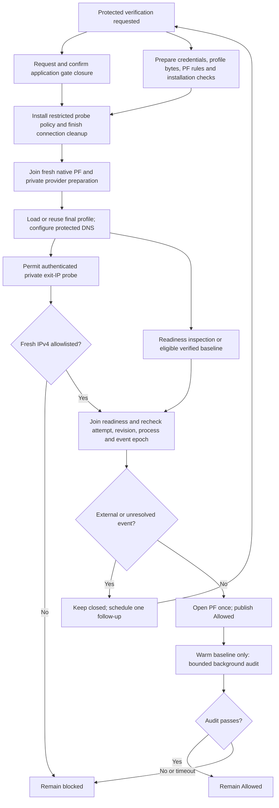
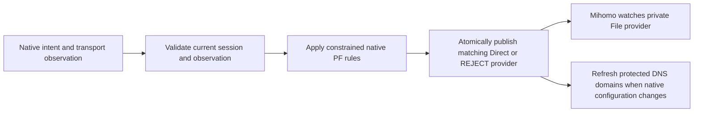

# Mimo event-driven workflows

Updated 2026-11-21 for **1.0 (build 3)**. This implementation reference includes scoped MagicDNS access, native resolver search domains and uniform monitoring ages. The integrated firewall candidate passed on the affected physical Mac; the permanent policy is packaged and installed in mimo-vm with fresh-query, revocation and recovery checks. See [build 3 evidence](../Tests/ReleaseEvidence/mimo-build-3-magicdns.json) for scope and remaining limits. The [DNS comparison](../Scripts/diagnose-magicdns.pl) and [service snapshot](../Scripts/diagnose-mimo-services.sh) remain read-only diagnostics.

The [design plan](../MIMO_PLAN.md) records design decisions and earlier sequences. For current event handling, use this document and the linked source. [Failure scenarios](MIMO_FIREWALL_AND_FAILURE_SCENARIOS.md) describe the broader protection limits.

## Contents

- [Ownership and states](#ownership-and-states)
- [Trigger inventory](#trigger-inventory)
- [Startup, shutdown and recovery](#startup-shutdown-and-recovery)
- [Protected verification](#protected-verification)
- [Network changes and event coalescing](#network-changes-and-event-coalescing)
- [Native Tailnet and provider changes](#native-tailnet-and-provider-changes)
- [Sleep, wake and user sessions](#sleep-wake-and-user-sessions)
- [User commands and shared settings](#user-commands-and-shared-settings)
- [Lookup scheduling and failures](#lookup-scheduling-and-failures)
- [Runtime faults and background audits](#runtime-faults-and-background-audits)
- [GUI, widgets and diagnostics](#gui-widgets-and-diagnostics)
- [Installation and release events](#installation-and-release-events)
- [Timing and diagnostic reference](#timing-and-diagnostic-reference)
- [Validation map and maintenance](#validation-map-and-maintenance)

## Ownership and states

| Component | Owns | Does not own |
| --- | --- | --- |
| `mimo-core` / `DaemonService` | Shared settings and revisions, lookup scheduling, quotas, credentials, client subscriptions, native connection intent and diagnostic HTTP provider | Final PF permission to open traffic |
| `MimoCoordinator` in core | Ordered supervisor requests, lookup generation, authenticated private exit-IP probe | An independent network event observer in the installed service |
| Independent `MimoSupervisor` | PF transitions, profile delivery, runtime readiness, native PF/provider publication, network/power/session observation, service operations and recovery | GUI lifetime |
| `mihomo` | Loaded profile, TUN, proxy/DNS listeners and routing, watching the private File provider | Authority to release Mimo's PF gate |
| Independent boot/infrastructure jobs | Saved PF installation and periodic PF/launchd repair | Exit-IP approval |
| GUI and widgets | Displaying shared state and issuing authorized commands | Traffic enforcement or authoritative cached approval |

**Protected** below means Rule or Global. Direct restores unproxied IPv4 without allowlist approval; IPv6 remains denied in every mode. A previously displayed IP is not a new approval. A successful IP lookup alone is not proof that the traffic gate opened.

| Routing phase | Meaning |
| --- | --- |
| `unavailable` | Current enforcement/status cannot be confirmed. |
| `restoringDirect` | Removing managed routing and the temporary DNS override. |
| `closing` | Closure requested; the UI must not claim confirmed blocking yet. |
| `blocked` | Protected access remains closed, including failures or waiting between checks. |
| `validating` | Profile preparation/readiness is underway with ordinary application traffic closed. |
| `checking` | The authenticated private exit-IP probe is available; ordinary application traffic remains closed. |
| `active` | Effective Direct, or approved Rule/Global. A permitted warm background audit does not change this to Checking. |

Sources: [routing policy](../Sources/MimoShared/MimoRouting.swift), [coordinator](../Sources/MimoService/MimoCoordinator.swift), [supervisor](../Sources/MimoService/MimoSupervisor.swift), [presentation](../Sources/MimoShared/MimoStatusPresentation.swift).

## Trigger inventory

This inventory includes OS callbacks, polled state transitions, user commands and timer completions. Polling is how some external events are detected; it is not itself an instruction to check the exit IP.

| Trigger | Receiver / workflow | Protected behavior | Direct behavior |
| --- | --- | --- | --- |
| Boot, supervisor or core startup | Startup / saved configuration | Guard, respect service intent, fresh verification before release | Restore Direct; startup lookup observes IP |
| Select Rule/Global, including switching between them | Shared routing transaction → verification | Close and verify current saved configuration | Leaving Direct arms a protected cycle |
| Select Direct | Shared routing transaction → Direct restore | Cancel obsolete approval and restore Direct after persistence | Remain Direct |
| Save/remove proxy; change allowlist/provider settings or lookup credential | Settings transaction | Invalidate and verify | Refresh observation without allowlist enforcement |
| Refresh now, Retry verification, provider Test | Monitor refresh scheduler | Run the protected verification workflow if a lookup is admitted | Observe IP without closing |
| Periodic interval, quota/cooldown retry, queued refresh | Monitor scheduler | Same protected lookup path; no special periodic bypass of PF preparation | Observe IP |
| External IP, DNS, proxy, route, interface, service-order, location or VPN change | Supervisor network observer | Early revocation, classified event, fresh verification | Ordinary event ignored for lookup; IPv4 policy still maintained |
| Recognized AirPort telemetry or unchanged location apply | Callback-side filters | No verification and no early closure | Same |
| Exact owned TUN/DNS mutation | Ownership classification | No additional verification; resolve any pending event classification | Same |
| Validated private native Tailnet connect/disconnect | Private Tailnet classifier + native observers | Update native PF/provider and protected DNS in place | Update native integration; no public gate cycle |
| Tailnet exit-node/subnet/public/unknown change | Conservative network classification | Verification required | Ordinary event ignored for lookup |
| Mimo provider Start/Stop/Restart | Core settings + supervisor native writer | Update private Tailnet access in place when public access is already approved | Preserve Direct |
| Diagnostic provider port occupied/listener failure | HTTP provider service | Rebind/retry independently of the File provider and profile | Same |
| System will sleep / wake / sleep cancelled | IOKit power guard | Revoke old epoch and hold closed; verify after wake | No allowlist gate or event-driven lookup |
| Lock/unlock, login/logout, console-user switch, display sleep/wake | Session sampler | Revoke and verify; unavailable observation is also relevant | No event-driven lookup |
| Core heartbeat loss, engine death, unexpected gate state | Supervisor watchdog | Close; recover through fresh verification | Direct recovery remains available |
| Missing resolver, failed readiness/native/PF audit or audit timeout | Supervisor audit/recovery | Close, invalidate reusable baseline, recover and verify | Do not let a delayed protected fault close a newer Direct selection |
| Core/mihomo Start/Stop/Restart; profile Reload | Supervisor service workflow | Confirm closure before mutation; Start/Restart/Reload requests verification | Preserve Direct; no proxy approval needed |
| PF/launchd damage or service recovery | Independent guard + supervisor repair | Repair closed, respect Stop flags, fresh verification | Maintain infrastructure and restore saved Direct when permitted |
| GUI launch/reopen/focus, screen/session UI notification, GUI quit | Client subscription and presentation | Read/display state; no lookup solely because the dashboard opened | Same |
| Country-only metadata change or highlight expiry | Snapshot/presentation update | No extra lookup or gate cycle | Same |
| Appearance/login-item setting, copy, log pause/export, Open profile | Presentation/read-only workflows | No routing mutation | Same |
| Install/upgrade/repair/uninstall | Installer/cleanup | Maintenance guard and rollback/restoration workflow | Persisted mode and settings handled by installer |

## Startup, shutdown and recovery

1. Independent boot protection loads the saved blocking PF policy. Core/supervisor entry closes the startup guard before slower setup. Traffic before the independent guard actually loads is outside the demonstrated guarantee.
2. Supervisor starts the power guard, checks installation, initializes native transport to a constrained state, loads saved routing and service flags, and honors maintenance mode. It starts/stops the engine and core according to persisted intent.
3. Saved Direct is restored without an exit-IP approval. Saved Rule/Global remains closed pending core verification. A supervisor-only restart also marks verification recovery pending: an existing core heartbeat does not reinstate old approval.
4. Core starts its separate liveness pulse and state channel, loads settings/credentials, enables the diagnostic provider, then starts monitoring and its startup lookup. Native connection-intent observation starts after initialization.
5. Network/session/native observers, watchdog and infrastructure repair continue independently of the GUI.

Core Stop cancels monitor work, timers, provider publication and subscriptions. Protected access is closed by the supervisor/liveness policy; saved Stop intent prevents immediate respawn. Supervisor Stop closes protected access before its own observation ends. GUI Quit only disconnects the UI.

Administrator Direct recovery stops core, confirms it stopped, persists Direct and increments the settings revision, restores Direct through the supervisor, then restarts core only if it had been enabled. Persistence failure must not silently release traffic. Sources: [entry point](../Sources/MimoService/DaemonMain.swift), [core startup](../Sources/MimoService/DaemonService.swift), [Direct recovery](../Sources/MimoService/MimoDirectRecovery.swift).

## Protected verification

The current installed coordinator sends every admitted protected lookup through `prepare → probe → approve`. This includes scheduled/manual lookups. An active background readiness audit is a different operation and does not itself request a lookup.

### Preparation and opening order

1. Arm the power/event fence before the first suspension, even when saved policy still describes the previous Direct state. Begin one cycle and invalidate superseded work.
2. Request gate closure. Concurrently prepare restricted PF rules, retrieve credentials/render profile bytes, inspect installation when required, and clear old controller connections. Confirm actual blocking before installing the probe policy.
3. For a hostname proxy, retire the previous TUN using the credential-free blocking profile before restricted bootstrap resolution. Resolve IPv4, then install endpoint-specific probe rules while ordinary traffic stays closed. Literal IPv4 skips this bootstrap dependency.
4. Join native transport prerequisites. A successful observation no older than one second may be reused; otherwise take a fresh bounded observation. **Apply native firewall rules, then atomically publish the matching private provider file, before loading the final profile.** If either fails, do not proceed to public approval.
5. Load the final profile once, or reuse it only when its bytes and engine identity match. Publish the temporary protected DNS resolver ([builder](../Sources/MimoShared/MimoProtectedDNS.swift)). It claims every domain and so becomes the system default; configd then ignores other supplemental services' own search lists. The resolver therefore carries the search domains of native resolvers that claim every domain (MagicDNS), then of the primary service, with saved settings overriding DHCP. Direct removes it and the native search list returns unchanged. A Tailnet DNS change republishes it under the existing owned-change fence. Start readiness inspection after native prerequisites are ready, unless an eligible verified baseline permits the warm path.
6. Permit the authenticated private probe, restricted to configured lookup-provider destinations through the configured proxy. Ordinary proxy/TUN/DNS entry points remain blocked. The probe has no automatic Direct fallback.
7. Require a fresh allowlisted IPv4. Empty or mismatched allowlist stays blocked. Country is not part of this decision.
8. Join critical readiness, or revalidate the warm baseline. Recheck the current attempt, saved revision, network generation, loaded profile, engine process, observers and infrastructure. The final PF mutation is serialized with the power/event fence.
9. Open once. Do not reload the profile after approval. On the warm path, begin a bounded audit while retaining Allowed; failure or timeout closes access and revokes reuse eligibility.

Cancellation/generation checks prevent an old prepare, lookup, audit or XPC reply from opening a superseded configuration or closing a newer Direct selection. A declined IP and a successful HTTP lookup may coexist in the logs: use `mimo_traffic_opened`, not `lookup_succeeded`, to identify actual release.

Sources: [prepare/approve implementation](../Sources/MimoService/MimoSupervisor.swift), [runtime mutations](../Sources/MimoService/MimoSystemRuntime.swift), [readiness](../Sources/MimoService/MimoReadinessChecks.swift), [private probe](../Sources/MimoService/MimoLookupSession.swift), [command ordering](../Sources/MimoService/MimoCommandFence.swift).

## Network changes and event coalescing

### Detection and classification

The installed supervisor owns `SCDynamicStore` and routing-socket observation. The installed `MonitoringEngine` is constructed with `observeSystem: false`; it receives supervisor notifications. The shared engine's standalone `NWPathMonitor` and five-second event-window path are retained for other/test consumers and must not be mistaken for a second installed observer.

Classification happens before early blocking wherever enough information is available:

| Notification | Ignored only when | Still relevant when |
| --- | --- | --- |
| AirPort | Unchanged or known telemetry such as `AutoJoinTimestamp`, `Busy`, radio/scan metrics | Association/power changes, unknown fields or unavailable reads |
| `Setup:` location root | Both `CurrentSet` values are known and unchanged, and only `LastUpdated` differs (or nothing differs) | Missing location, changed location, unknown field difference |
| Mimo DNS key | Actual resolver equals the recorded owned value | Removed, changed or unreadable resolver |
| Mimo TUN/interface/routes | Recorded interface/process/address and bounded ownership checks match | Unknown ownership, external interfaces/routes, conflicting changes |
| Global DNS publication | Nonnative DNS is unchanged, Mimo's resolver is intact, and selection exactly matches owned DNS or validated native selection | External DNS/configuration changes or unknown resolver metadata |
| Private Tailnet | The narrow conditions in the next section hold | Any unrecognized/public-network effect |

Filtering a key never discards unrelated keys in the same callback. An empty unclassified callback remains an unknown change. Profile mutation updates only owned-network baselines; it must not absorb a simultaneous external change into a new baseline.

### Event during an active cycle

An early callback can precede actor-side ownership classification. It creates a pending event token. Approval waits until that token is resolved: an owned change clears it; an external change marks the cycle dirty; an unresolved token prevents opening.

External events received during verification are accumulated with source/detail. Existing work can finish, but its stale result cannot open PF. Finishing that cycle schedules **one follow-up for that batch**, with `source: deferred_events`. This is not a global promise of at most two checks: a real new change during the follow-up can require another check. Known owned/telemetry changes must not perpetually dirty either cycle.

The active cycle takes precedence over an older Direct policy when attributing early events. Ordinary events outside a protected cycle in Direct do not request a lookup. They can still enforce the permanent IPv4 policy on newly added services.

Sources: [configuration filter](../Sources/MimoCore/NetworkConfigurationObserver.swift), [route decoder](../Sources/MimoCore/RouteChangeObserver.swift), [network observer](../Sources/MimoService/MimoNetworkObserver.swift), [event fence](../Sources/MimoService/MimoPowerGuard.swift), [ownership policy](../Sources/MimoShared/MimoNetworkChangePolicy.swift).

## Native Tailnet and provider changes

### Native Connect/Disconnect

Native connection intent is observed separately from transport readiness. `Starting`/`Running` mean enabled; explicit stopped/login-needed states mean disabled; failed or ambiguous observations mean unknown, not Off. Automatic settings changes wait while core is mutating settings, running a lookup or holding a user control.

The supervisor continuously discovers the verified native interface, official native transport sockets and constrained infrastructure. It is the sole writer of the engine's private File provider. Each accepted update performs:

The private provider is `Mihomo/proxy_providers/mimo-tailnet.yaml` under Mimo's machine support directory. It contains no full proxy profile credentials. The full profile references this stable file, so a native interface/provider change does not need a full profile reload. Old observation/session completions cannot republish Direct after Stop. Unchanged provider bytes are not rewritten.

Protected probe/Rule/Global policies call the same `native-transport` child twice: first with a root-only IPv4 TCP destination filter for `100.100.100.100:53`, then, after the ordinary DNS group block, for general native transport. The early call is not an unconditional pass: the child must match the freshly verified native interface. Emptying or replacing that child on Stop, disconnect or stale observation revokes/updates both paths in one native transaction. Public native transport exceptions use different ports and cannot match the early DNS call. Permission and power barriers remain outside this policy. No UDP, DoT or IPv6 exception is added, and Direct/startup policies are unchanged. This trusts root-owned sockets, not a particular executable; ordinary applications still encounter the DNS block. See [policy generation](../Sources/MimoShared/MimoFirewallPolicy.swift) and [firewall regression tests](../Tests/MimoSharedTests/MimoRoutingTests.swift).

An already approved public connection can stay open only when classification confirms separation from native Tailnet routing:

- The configured public proxy endpoint is IPv4 outside the Tailnet range and its outbound interface is known and separate from native/Mimo tunnels.
- Private addresses/routes remain within `100.64.0.0/10` or the native `fd7a:115c:a1e0::/48` identity range. Recognizing IPv6 notification metadata does **not** enable IPv6 traffic.
- A known native interface's scoped routes cannot change the separately bound public proxy path. Unscoped default/public/subnet routes are not treated as private.
- Native DNS matches Quad100 and known Tailnet domains/metadata. On disconnect, a native service may republish the exact unchanged underlying DNS servers; this is allowed only by strict comparison. Temporary native resolver selection on reconnect is accepted only while owned protected DNS remains intact and nonnative DNS is unchanged.
- Official native service registration and observed private interface state establish identity; an arbitrary `utun` name is insufficient. Unknown fields/configurations remain conservative.

Exit-node, subnet-router, unrelated VPN, proxy-path or public DNS changes still require verification. A native firewall/provider publication failure closes protected traffic; ordinary disconnected/disabled state is a valid REJECT provider, not a public-network failure. Failure to refresh protected DNS also closes access.

### Mimo provider Start/Stop/Restart

These commands control Mimo's integration, not the Tailscale application. Start prepares observation and diagnostic listening; Stop removes inner Tailnet permission and publishes REJECT. Restart runs Stop then Start. The core persists the shared setting/revision and asks the supervisor to apply it while preserving existing public approval.

The normal UI control is queued behind an in-flight lookup. If a provider change nevertheless reaches an active transition, core invalidates that result and joins a follow-up, rather than allowing approval against old settings. Automatic native intent following only reacts when its observed intent changes; it does not continuously overwrite a manual Stop with an unchanged Running observation.

### Diagnostic HTTP endpoint

The loopback HTTP provider/status endpoint is separate from engine delivery. It first binds port `18766`; if occupied, the kernel selects and reserves an available fallback. The actual port is published to status/diagnostics. Listener failure is retried. No fixed-port availability is required for the private File provider, and a port change does not rewrite or reload the full active profile.

Native DNS selection metadata can include `__IF_INDEX__` during reconnect. The classifier validates it against the current interface of the identified native service before removing the bookkeeping field. Zero, unknown, stale/different indices, changed DNS servers and unknown resolver fields remain external events; the public-route and protected-resolver checks still apply. This avoids an extra block/verify cycle for a valid native DNS selection without suppressing an entire notification batch. The focused Tailnet tests cover these cases.

Sources: [intent following](../Sources/MimoService/MimoTailnetLifecycle.swift), [native observer](../Sources/MimoService/MimoNativeTransportObserver.swift), [PF/file writer](../Sources/MimoService/MimoNativeTransportWriter.swift), [private notification classifier](../Sources/MimoService/MimoTailnetNetworkChanges.swift), [classification policy](../Sources/MimoShared/MimoTailnetChangePolicy.swift), [HTTP service](../Sources/MimoService/TailscaleProviderService.swift).

## Sleep, wake and user sessions

IOKit power callbacks run on a dedicated queue. `CanSystemSleep` is acknowledged. For `SystemWillSleep`, the fence marks sleeping, increments its epoch, closes protected PF and only then acknowledges. Failed closure is logged and not acknowledged as ready; macOS can still force sleep at its deadline. While sleeping, preparation cannot arm approval. Wake and cancelled sleep advance the epoch, retain/reassert the protected barrier, then request verification. A session event cannot clear the sleep hold.

The independent session observer samples numeric login/console identities, lock state and display sleep state. It emits changes for `screen_locked`, `screen_unlocked`, `user_login`, `user_logout`, `console_session_changed`, `display_sleep` and `display_wake`. Observation loss/restoration is also relevant. It revokes the epoch and closes the protected barrier before waiting on the supervisor actor. Failed closure retains the transition for retry on the next sample.

The same callbacks do not close Direct or schedule ordinary Direct IP checks. Some low-level log action labels say `direct_refresh`; the installed supervisor subsequently ignores that ordinary event for lookup. GUI focus/display notifications only reread shared state and are not the enforcement mechanism.

Sources: [power guard](../Sources/MimoService/MimoPowerGuard.swift), [session observer](../Sources/MimoService/MimoSessionObserver.swift), [session comparison](../Sources/MimoShared/MimoSessionSnapshot.swift).

## User commands and shared settings

Core serializes human refresh, provider Test, routing, proxy, credential and settings commands. The supervisor separately queues service operations behind its active cycle/operation. These are per-owner queues, not a single global transaction queue. Waiting holds no PF/lifecycle lock. Read-only state, events and heartbeats bypass the user queue.

Mode-only commands are rebased onto the latest configuration when their turn arrives. Full proxy/settings edits require the expected revision and report conflict if stale; they cannot overwrite another account's changes. Mutation flow is validation → invalidate affected verification → persist settings/secret and revision → update routing/provider state → schedule required refresh → publish. Secret writes are rolled back if settings persistence fails; rollback failure is reported.

`MachineSettings.affectsVerification` covers provider, provider pool, refresh interval and allowlist. Presentation/diagnostic/provider-only changes preserve current public access when no verification is active. Token changes and proxy save/removal invalidate protected verification. Direct selection persists before restoration and does not preemptively close Direct just to change the selection.

Service Start/Stop/Restart and profile Reload confirm protected blocking before launchd/controller work. If blocking cannot be confirmed, the service change is aborted. Intent is persisted before the operation; a failed Stop must not silently become automatic Start later. GUI Start/Restart/Reload requests a fresh lookup after success. Core Stop leaves the independent supervisor available for Start. Open profile reads the delivered profile without reloading it.

Sources: [core transactions](../Sources/MimoService/DaemonService.swift), [control queue](../Sources/MimoService/MimoControlQueue.swift), [settings contract](../Sources/MimoShared/DaemonProtocol.swift), [GUI service commands](../Sources/MimoApp/PublicIPMonitor.swift).

## Lookup scheduling and failures

Refresh triggers are startup, manual, provider Test, settings change, supervisor network event, periodic timer, provider retry, queued deadline and in-flight recheck. The scheduler shares budgets, cooldowns and last-attempt times across accounts and restarts.

1. A queued user control holds automatic refreshes; pending work merges urgency/bypass intent until controls finish.
2. Concurrent requests share one lookup. Routine/manual duplicates are coalesced; relevant nonmanual forced events retain one pending recheck with the highest urgency.
3. Select an eligible provider and enforce persisted daily budgets/cooldowns. Explicit/startup/installed network refreshes can bypass spacing/burst limits, not daily exhaustion or provider failure pauses. Missing required IPinfo credentials does not spend a request.
4. Record an admitted attempt and run the current mode's lookup. Managed routing has a 60-second overall budget; HTTP has its own deadline.
5. On success, normalize IPv4, update snapshot/provider health, authorization and display. Unknown/different country alone does not schedule another check. A country highlight requires an IP change and expires independently.
6. An actual lookup error pauses that provider for eight hours or a longer Retry-After, persists the pause, and tries the next eligible provider after the current task unwinds. A profile/service preparation error is not evidence that the lookup provider failed and does not receive that pause.
7. If providers/budget/credentials make a required protected check unavailable, invalidate access and remain blocked. Direct retains networking and shows the observation failure. Retry/deferred timers do not confer approval.
8. Stop or configuration invalidation cancels pending work and advances the lifecycle generation; late results are discarded.

Sources: [monitor engine](../Sources/MimoCore/MonitoringEngine.swift), [refresh gate and budgets](../Sources/MimoShared/LookupBudget.swift), [failure policy](../Sources/MimoShared/ProviderFailurePolicy.swift).

## Runtime faults and background audits

Core sends independent liveness pulses and state requests. The supervisor validates the current core PID/controller/sequence and measures heartbeat age from actual receipt, so a delayed state request cannot hide a stopped core. Missing heartbeat, dead engine or unexpected PF state closes protected access.

A warm verified baseline is reusable only for the matching loaded profile/process and current healthy state. After a fresh allowlisted exit opens traffic, a background audit checks installation, runtime readiness, policies and native state. It must finish within three seconds. The timeout closes a barrier independently of actor progress. Audit failure revokes the baseline, forces a future profile load and marks recovery pending; successful audit keeps the UI Allowed.

While protected access is active, watchdog inspections continue after the background audit. Status/heartbeat reads also compare protected DNS immediately. Losing the owned resolver revokes approval rather than leaving a stale Allowed display until the next scheduled IP check.

Native-writer faults close protected access and request one recovery when native rules are healthy again. Infrastructure scans repair PF/launchd while respecting saved Stop intent. Recovery clears pending flags only after the current verification/audit succeeds; it never restores an old IP approval by itself. Direct restoration is retried when saved Direct is permitted but the runtime gate is not Direct.

Sources: [watchdog and recovery](../Sources/MimoService/MimoSupervisor.swift), [heartbeat lease](../Sources/MimoService/MimoHeartbeatLease.swift), [audit deadline](../Sources/MimoService/MimoAuditDeadline.swift), [runtime infrastructure](../Sources/MimoService/MimoSystemRuntime.swift).

## GUI, widgets and diagnostics

GUI startup acquires the single-instance role, creates the menu-bar item, subscribes to core and synchronizes the per-user login item. Dashboard reopen/focus fetches shared state. Core publishes snapshot/provider/routing/settings changes through subscriptions; the GUI reconciles streamed service progress with later state. A disconnected UI marks cached data stale, reads supervisor status and retries connection. Reconnecting does not itself request a lookup.

The menu bar, dashboard and widgets derive status from routing state and freshness. `mimo_access_presentation_changed` records a display transition, not its cause. Background auditing can retain Allowed. The warning window is shown only to the relevant active user for an unapproved address; clearing/dismissing display indicators does not approve traffic.

All six dashboard monitoring rows display status and inspection age as `Healthy(n secs)` using one one-second UI timeline. PF/launchd retain the independent infrastructure inspection time. The supervisor stamps core/engine launchd observations and profile-hosting intent when refreshing its two-second service cache; cached replies retain that timestamp. The core's Tailnet provider carries its observation/listener-state time. A running report older than 35 seconds displays `Stale(n secs)`; one without a valid inspection time displays `Unavailable(—)`. Stopped/restarting/failure states keep their meaning and use the same age suffix. Rendering cannot create a new inspection time, change PF, perform a lookup or grant access. The labels express the recorded checks, not end-to-end DNS validation. Sources: [shared status and formatting](../Sources/MimoShared/MimoRouting.swift), [supervisor cache](../Sources/MimoService/MimoSupervisor.swift), [provider observations](../Sources/MimoService/TailscaleProviderService.swift), [dashboard](../Sources/MimoApp/MimoViews.swift).

Widget timeline reads fetch daemon state and cache it for outages. A failed fetch presents unavailable/stale state. Timeline reload and Control Center activation do not perform an independent exit-IP check; the control opens the dashboard. Appearance and login-item choices affect that account's interface, not machine services.

Event Log polls core/supervisor and subscribes to GUI log writes, merges recent readable events, and labels missing/stale diagnostic sources. Pause or text selection holds displayed updates without stopping monitoring. Copy All exports readable events; Copy Diagnostics exports source-separated records with version/build and the current IP-redaction policy. Successful copy controls show a checkmark/“Copied” for two seconds; failed writes do not show success. Closing Event Log stops its polling only.

The manual [service snapshot](../Scripts/diagnose-mimo-services.sh) bounds read-only commands for machine/build identity, Mimo processes and launchd jobs, saved service intent, gate marker, controller/listeners, permission/power guards and the protected resolver. It performs no repair/restart or PF/profile/provider mutation. Use it when the displayed status conflicts with commands on the same Mac; the snapshot does not itself prove or restore an access grant. It reads no proxy profile, credential or full process argument list.

Sources: [app lifecycle](../Sources/MimoApp/MimoApp.swift), [client](../Sources/MimoApp/PublicIPMonitor.swift), [login item](../Sources/MimoApp/LoginItemSync.swift), [widgets](../Sources/MimoWidgets/MimoStatusWidget.swift), [log window](../Sources/MimoApp/EventLogWindow.swift), [copy feedback](../Sources/MimoApp/MimoCopyButton.swift).

## Installation and release events

Install/upgrade enters maintenance, preserves settings/credentials and service intent, stages the pinned engine and signed app/helper, updates launchd/PF installation and the installed-app identity, then starts the intended services. Protected access is not released just because installation completed: startup verification still applies. Failure uses the installer rollback path. Cleanup removes owned services, runtime files and PF references, removes the temporary DNS override, and restores journaled IPv6 service flags while preserving unrelated settings.

Deleting `Mimo.app` alone is not this cleanup workflow. Use the documented [clean uninstall](../README.md#clean-uninstall-and-reinstall).

For every **new GitHub build upload**, advance `Configuration/BuildNumber.txt` once even if the version remains `1.0`. Local rebuilds may reuse the unpublished candidate number. Generation propagates the number to bundles; packaging records version/build and artifact hashes in `release-build.json`. Release notes, dashboard, diagnostics and uploaded manifest must agree. Packaging does not itself publish or trigger a workflow.

Sources: [installer preflight](../Scripts/pkg/preinstall), [postinstall](../Scripts/pkg/postinstall), [service setup](../Sources/MimoDaemon/setup.command), [cleanup](../Sources/MimoDiagnostics/cleanup-installation.sh), [packaging](../Scripts/package-release.sh), [repository release rule](../AGENTS.md#release-build-identity).

## Timing and diagnostic reference

These are configured polling intervals/deadlines, not end-to-end latency guarantees. Bounded command execution and scheduling can extend the time between completed samples.

| Activity | Current value / behavior | Source |
| --- | --- | --- |
| Core liveness pulse and supervisor state loop | Separate loops, about 1 second each | `MimoCoordinator` |
| Heartbeat expiry | 5 seconds | `MimoHeartbeatLease` |
| Supervisor watchdog | 1-second delay plus completed inspection work | `MimoSupervisor` |
| Infrastructure repair | 10-second delay between passes | `MimoSupervisor` |
| Session sample | 500 ms | `MimoSessionObserver` |
| Native socket / interface / infrastructure observation | 250 ms / 2 seconds / 10 seconds | `MimoNativeTransportObserver` |
| Native intent / diagnostic provider observation | 2 seconds | `MimoTailnetLifecycle`, `TailscaleProviderService` |
| Provider listener readiness / retry | Up to 2 seconds / 5 seconds | `TailscaleProviderService` |
| Prepared native observation reused before profile | At most 1 second old | `MimoSystemRuntime` |
| Owned profile-route classification window | 2 seconds, measured at receipt, with ownership constraints | `MimoNetworkObserver` |
| Warm background audit | 3-second deadline | `MimoAuditDeadline` |
| Managed lookup / HTTP resource | 60 seconds / 15 seconds | `MonitoringEngine`, `MimoLookupSession` |
| Human queue | At most 32 waiting entries; 65-second deadline | `MimoControlQueue` |
| Periodic lookup | Configurable 5/15/30/60 minutes | `RefreshInterval` |
| GUI state poll / reconnect / displayed age | 15 seconds / 3 seconds / 60 seconds | `PublicIPMonitor` |
| Event Log service poll / copy feedback | 2 seconds / 2 seconds | `EventLogWindow`, `MimoCopyButton` |
| Widget timeline request | 1 hour; WidgetKit controls delivery, state changes also request reload | `RefreshPolicy`, widget provider |

| Diagnostic question | Records to correlate |
| --- | --- |
| Why did a check start? | `refresh_requested.trigger`, `mimo_network_changed.source/detail/generation`, `mimo_routing_changed.revision` |
| Was Wi-Fi/location noise filtered? | `network_airport_telemetry_ignored`, `network_location_metadata_ignored`; relevant alternatives are `network_airport_connection_changed`, `network_location_changed` |
| Was it an owned or private change? | `mimo_cycle_owned_event_ignored`, `mimo_network_owned_dns_selected`, `mimo_tailnet_configuration_updated`, `mimo_tailnet_change_scope` |
| Why a second check? | `mimo_cycle_event_deferred`, then `mimo_network_changed` with `source: deferred_events` and retained detail |
| Were native prerequisites ready before the profile? | `mimo_native_provider_published`, `mimo_profile_prerequisites_ready`, then `mimo_final_profile_loaded` or `mimo_final_profile_reused`; correlate attempt IDs |
| Did traffic really open? | `mimo_private_probe_ready` → `mimo_exit_ip_approved` → `mimo_opening_barrier_ready` → `mimo_traffic_opened`; readiness may finish before the probe |
| Why did it stay closed? | `mimo_exit_rejected`, `lookup_failed`, `provider_failure_paused`, `lookup_all_providers_paused`, `lookup_daily_budget_exhausted`, `mimo_gate_closed.reason/confirmed` |
| Did a warm audit finish? | `mimo_background_audit_started`, then `mimo_background_audit_passed`, `mimo_background_audit_failed` or `mimo_background_audit_timeout` |
| Was the service/observer unhealthy? | `mimo_liveness_lost`, `mimo_dns_configuration_lost`, `mimo_verification_audit_failed`, `mimo_native_transport_failed`, `network_configuration_monitor_unavailable`, `mimo_session_guard_failed` |
| Was a human action waiting? | `mimo_control_queued` → `mimo_control_resumed`; service progress uses `mimo_service_change_begin/changed/failed` |
| Which diagnostic port is live? | `tailscale_provider_port_conflict`, `tailscale_provider_listening.port/fallback`, `tailscale_provider_prepared` |
| Is the log only reporting UI? | `mimo_access_presentation_changed` and `widget_reload_requested` do not establish a network cause or an open/close operation |

Repeated `mimo_gate_closed` records can describe successive confirmations during one continuously closed period. Two Blocked display entries do not establish an intervening release. To prove a block-open-block cycle, locate `mimo_traffic_opened` between confirmed closures. To prove redundant verification, count distinct probe attempts and inspect the triggering events.

## Validation map and maintenance

| Workflow | Relevant tests / evidence |
| --- | --- |
| Telemetry/location filtering and event ownership | [AirPort tests](../Tests/MimoSharedTests/AirPortChangeFilterTests.swift), [location tests](../Tests/MimoSharedTests/NetworkLocationChangeFilterTests.swift), [cycle tests](../Tests/MimoServiceTests/mimo_cycle_tests.swift), [installed route/location test](../Tests/MihomoRuntimeTests/release_cycle_classification_test.py) |
| Private Tailnet and provider ordering | [policy tests](../Tests/MimoSharedTests/MimoTailnetChangePolicyTests.swift), [native observer tests](../Tests/MimoServiceTests/mimo_native_observer_tests.swift), [notification tests](../Tests/MimoServiceTests/mimo_tailnet_network_tests.swift), [installed live-update test](../Tests/MihomoRuntimeTests/release_tailnet_live_update_test.py) |
| Power/session/late commands | [power tests](../Tests/MimoServiceTests/mimo_power_tests.swift), [session tests](../Tests/MimoSharedTests/MimoSessionSnapshotTests.swift), [command fence tests](../Tests/MimoServiceTests/mimo_command_fence_tests.swift), [coordinator tests](../Tests/MimoServiceTests/mimo_coordinator_tests.swift) |
| Readiness, audit, resolver loss and recovery | [gate tests](../Tests/MimoServiceTests/mimo_gate_tests.swift), [recovery tests](../Tests/MimoServiceTests/mimo_recovery_tests.swift), [installed audit test](../Tests/MihomoRuntimeTests/release_optimistic_audit_test.py), [DNS test](../Tests/MihomoRuntimeTests/release_dns_privacy_test.py), [resolver search-list tests](../Tests/MimoSharedTests/MimoProtectedDNSTests.swift), [installed MagicDNS test](../Tests/MihomoRuntimeTests/release_magicdns_test.py) |
| Refresh admission, pauses and metadata | [refresh scenarios](../Tests/MimoSharedTests/RefreshScenarioTests.swift), [failure-policy tests](../Tests/MimoSharedTests/ProviderFailurePolicyTests.swift), [country UI tests](../Tests/MimoAppTests/mimo_country_tests.swift) |
| UI status, log export and copy | [service age/cache tests](../Tests/MimoSharedTests/MimoServiceStatusTests.swift), [dashboard tests](../Tests/MimoAppTests/mimo_dashboard_tests.swift), [log tests](../Tests/MimoAppTests/event_log_tests.swift), [copy tests](../Tests/MimoAppTests/copy_feedback_tests.swift), [disconnect test](../Tests/MihomoRuntimeTests/release_ui_disconnect_test.py) |
| Install, repair, uninstall and persisted intent | [install tests](../Tests/MimoInstallTests/run.sh), [installed lifecycle tests](../Tests/MihomoRuntimeTests/installed_acceptance_test.py), [upgrade tests](../Tests/MihomoRuntimeTests/upgrade_test.py) |

Tests listed here establish where behavior is checked, not that every scenario passed for every build. Use dated [release evidence](../Tests/ReleaseEvidence/) and [README validation limits](../README.md#validation-and-known-limits) for qualification. VM-injected power events are not physical sleep/wake evidence. VM results alone did not qualify the physical-Mac failure; the integrated candidate now has a separate passing physical result below.

The [build 2 qualification record](../Tests/ReleaseEvidence/mimo-build-2-workflows.json) covers the build's installed Rule transitions, native/provider live updates, shared and focused service checks, dashboard renders and exact artifact identity. Subsequent physical-Mac comparison found that native DNS under the runtime group and fresh Mihomo instances also fail in Rule; a Direct TCP DNS query succeeds without reconnecting native Tailscale. The subsequent `--trace` result identifies Mimo's TCP port-53 group-negation block: three additional blocked packets, no additional native-anchor evaluations and only TCP resets on the native interface. Why socket-owner lookup differs from the expected process group remains unresolved. The search-domain correction above is separate from this full-name failure.

The [standalone firewall experiment](../Scripts/test-magicdns-firewall.pl) is a manual test, not an installed workflow. It requires an open protected gate and matching native provider/route, inserts a unique temporary child anchor into `open-policy`, and tests root-only then (if needed) owner-independent TCP Quad100 exceptions on that interface. It clears ordinary engine DNS cache for each query, confirms rule packet counters, and removes only its own reference/rules under the existing mutation/revocation locks. Permission/power barriers, profile, provider, services and routes are untouched; no closed gate is reopened. A detached watchdog removes the exception on parent death or timeout. The owner-independent test temporarily allows ordinary processes to query Quad100, so success is transport evidence, not qualification of a permanent privacy policy. VM tests verify normal completion, the fallback branch, interruption, parent death and timeout preserve existing policies. On the physical Mac, the root-only branch returned the correct full-name answer from both the engine and local listener, with seven pass-rule packets; the broader fallback was unused and the script restored its rules.

The subsequent [candidate script](../Scripts/test-magicdns-candidate.pl) tests the integrated early root/TCP/Quad100 call, placed after loopback/TUN rules and before the group guard. A unique removable wrapper delegates to the existing live `native-transport` child; the script never writes that child, so native Stop/disconnect/expiry still controls revocation. No owner-independent fallback is used. Three uncached engine queries and uncached local-listener queries over TCP and UDP must return Tailnet IPv4 addresses; synthetic fake-IP answers fail. A macOS system-resolver lookup must also return a Tailnet IPv4 address. The existing restoration/watchdog mechanism removes the wrapper/reference without replacing a newer policy or reopening a gate. Cleanup preserves the original failure exit code. [VM script tests](../Tests/MihomoRuntimeTests/magicdns_candidate_script_test.py) pass normal operation, interruption, parent termination and timeout with parent/open/permission/power policies restored. This script applies only a temporary test; it neither builds nor installs an app.

The integrated source changes pass 219 shared tests, focused native/profile-preparation and cancellation tests, and light/dark dashboard renders including stale/missing service timestamps. Temporary VM fixtures of the generated scoped PF call pass root DNS and installed-engine/local-listener queries, block ordinary direct TCP/UDP DNS, add no root UDP exception, reject a different native interface and revoke access when the native child is cleared. Short fixtures confirmed original-policy/permission restoration; an earlier longer fixture lost controller availability before completion and is not counted as a full pass. Build 3 now packages these changes; installed VM checks verify the permanent policy without a temporary wrapper. The affected physical Mac has live Mimo jobs, a responding controller and DNS listeners. The affected physical Mac passed the candidate from a failing baseline: all three uncached engine queries, both local-listener transports and macOS resolution returned the same Tailnet IPv4 address. The script restored its temporary wrapper and left the live native policy, permission gate and app unchanged. The installed build 3 package passes three fresh engine queries, root TCP DNS with a different group, ordinary DNS blocking, provider revocation/recovery and Rule/Global DNS recovery checks. Short-name resolver construction is unit-tested; the installed peer short-name check is skipped because the VM has no online own-tailnet peer. Monitoring ages remain observations, not DNS proof. See the [installed firewall regression](../Tests/MihomoRuntimeTests/release_magicdns_firewall_test.py) and [build 3 evidence](../Tests/ReleaseEvidence/mimo-build-3-magicdns.json).

When adding/changing an event, update its inventory row, owning workflow, blocking/Direct behavior, coalescing/cancellation rules, diagnostic records and validation mapping here. Update the README feature/manual-check entries in the same change. Keep unrelated presentation changes out of network verification and never broaden an ignore rule solely to make a noisy trace disappear.
