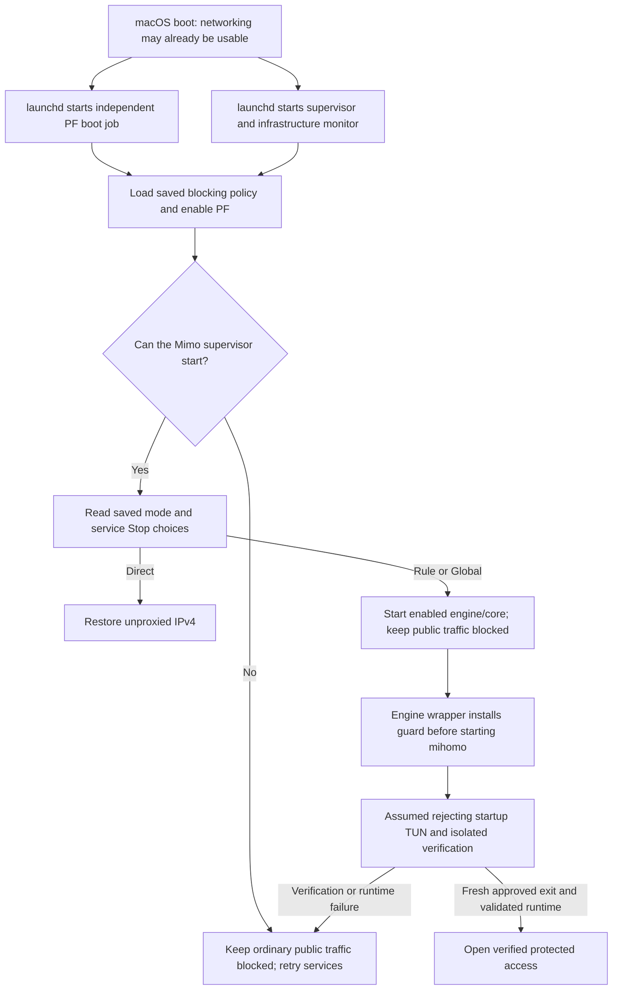

# Mimo firewall and failure scenarios — TUN-enabled baseline

Updated: 2026-11-19. Scope: Apple silicon, IPv4-only Mimo + pinned mihomo, **assuming TUN is already enabled in the protected startup profile**, plus the conditional Developer ID / Network Extension assessment in section 13. The independent PF boot loader, active infrastructure repair and dashboard health reporting described below are current implementation changes. Startup TUN remains an analysis assumption, not a new release qualification.

> [!IMPORTANT]
> **Analysis baseline:** protected startup uses `tun.enable: true`, correctly installed IPv4 routes and a rejecting profile. Ordinary traffic entering that TUN is rejected until a verified Rule/Global configuration authorizes it. Verification must keep ordinary TUN traffic rejected while separately allowing the authenticated probe. Direct deliberately removes interception using a separate idle configuration. “TUN enabled” in a file is not the same as a running engine with effective routes.
>
> The repository's [startup-profile generator](../Sources/ExitIPShared/MihomoProfile.swift) still emits `tun.enable: false`; that implementation difference is not used as the baseline below. Existing test evidence describes its recorded builds and does not qualify this assumed change. The new independent loader can install PF without executing Mimo or mihomo; the normal engine wrapper still establishes PF before starting mihomo.

## 1. What the assumed design protects

Mimo uses macOS's **PF packet firewall as its independent traffic barrier**. A separate boot job loads a saved blocking policy using macOS Perl and system tools. It does not execute `mimo-core` or mihomo. The supervisor later restores Direct or manages verified protected access; a separate infrastructure job checks PF and launchd. The kernel enforces installed rules even when those processes stop. Under this document's TUN assumption, mihomo also rejects captured traffic at protected startup. TUN enforcement depends on mihomo, its loaded profile and the paths entering its tunnel.

Failure behavior depends on **both PF and the loaded TUN policy before the failure**:

- **No effective PF, but a working rejecting TUN:** traffic captured by that TUN is blocked. Traffic outside its coverage has no PF backstop.
- **Neither effective PF nor a working rejecting TUN:** a saved YAML file or stopped process does not prevent ordinary internet access.
- **Blocking firewall installed:** ordinary public traffic remains blocked even if all Mimo processes and mihomo subsequently stop, provided PF stays enabled and its effective rules are unchanged.
- **Active protected firewall installed:** the last permitted paths remain permitted until a successful close. The independent checker can close before repairing a missing/non-running supervisor; this is not immediate and does not cover every hang.
- **Direct firewall installed:** ordinary IPv4 internet access is intentional. IPv6 denial remains part of Mimo's installed policy.

**TUN being enabled is not equivalent to TUN rejecting traffic.** After activation, mihomo's Rule/Global profile intentionally forwards traffic. Loss of core/supervisor does not automatically reload the rejecting startup profile; the running engine can retain its active profile and connections. Likewise, a normal PF close must not be assumed to change the engine's rules unless a rejecting reload and connection revocation actually complete.

**OBSERVED LEAK — historical cold boot, not merely theoretical.** One captured reboot recorded **118 ordinary probe packets before the first confirmed guard**, zero ordinary probe packets after that boundary, and **4.892 seconds from the first captured ordinary packet to guard confirmation**. This predates the assumed startup-TUN change; it is not a measured leak size for the new baseline. It remains evidence of the earlier launch-order gap. See [boot evidence](../Tests/ReleaseEvidence/mimo-protected-boot.json).

**Current candidate versus published release (2026-11-19):** The normal Release candidate now permits Rule/Global after its actual firewall, profile, private-probe and saved-allowlist checks. The published 1.0 archive still has the former qualification gate. Current acceptance runs the exact packaged helper in `mimo-vm`; older VM-only helper results do not qualify this candidate. The assumed startup-TUN lifecycle and the first-packet boot gap remain distinct from these tests. See the [current execution record](../Tests/ReleaseEvidence/mimo-real-release-status.json) and [historical feature audit](../Tests/ReleaseEvidence/MIMO_FEATURE_AUDIT.md).

### Theoretical leakage scenarios

> [!WARNING]
> **Each T-number below identifies a theoretical leakage scenario discussed in this document.** It describes a condition under which direct bypass or stale approval could occur; it does **not** mean the scenario has produced a captured leak. The same identifiers highlight the relevant passages and failure-table entries below. Passing a representative recovery test does not establish that every timing window is leak-free.

“Stale approval” means traffic continues after the condition supporting its permission is lost; it need not be a direct connection. A delay or outage alone is not a leak. Intentional Direct access, authorized uninstall, ordinary LAN traffic and Rule-mode direct exceptions are not classified as leaks.

| ID | Theoretical scenario and necessary condition | Potential exposure | Where discussed |
| --- | --- | --- | --- |
| **T01** | **No initial guard:** public networking is usable before the independent PF loader or another effective barrier runs, or the independent loader also fails. | Exposure persists until a barrier covers the traffic. A working rejecting TUN can protect captured IPv4 traffic if independently started, but an enabled setting alone cannot. | Sections 3, 7 |
| **T02** | **Mihomo launched without the wrapper:** the original disabled-TUN gap is closed for traffic captured by the assumed working rejecting TUN. This case also assumes the independent PF guard is absent or ineffective. | Launching without the wrapper is no longer sufficient by itself for captured traffic to leak. Residual exposure requires incomplete setup, bypass, engine failure or an incorrect/permitting profile; see T06/T08/T13. | Sections 7, 10 |
| **T03** | **Failed or partial close:** a required firewall update/state flush fails while the previous policy or connection state still permits traffic, and no effective rejecting TUN stops that traffic. | Previously permitted traffic may survive. Startup TUN does not make an active profile revert to rejection. An effective PF deny or rejecting TUN still blocks the traffic it covers. | Sections 4, 9 |
| **T04** | **Supervisor lost while active:** crash, SIGKILL, whole-process suspension, failed shutdown cleanup or failed restart; mihomo or another previously permitted path remains usable. | The independent checker closes before repairing a missing/non-running supervisor. Permissions may persist before repair, if the checker also fails, or while a hung supervisor still appears running. There is no kernel-enforced approval expiry. | Sections 8, 9 |
| **T05** | **Detection/reaction delay:** core loss, engine/controller hang or supervisor scheduling stall occurs while active traffic can still move. | Traffic may continue after the relevant approval/liveness condition is lost and before closure. A heartbeat does not prove fresh exit-IP verification. | Sections 8, 9 |
| **T06** | **Incorrect running engine:** configuration drift or engine misbehavior changes forwarding before detection, or beyond the checks performed. | Unintended forwarding is possible. Rule-mode runtime-group direct permission particularly relies on mihomo's rule enforcement. | Sections 5, 9 |
| **T07** | **Proxy exit changes between observations:** the remote egress changes without an immediate local trigger, while traffic remains authorized by the previous result. | Traffic may use an address outside the allowlist before the next check closes access. | Sections 6, 9 |
| **T08** | **Network/interface assumptions change:** callbacks are delayed, an unqualified route/interface transition occurs, the owned TUN name is reused, or a new interface has usable IPv6 before denial is effective. | Stale routing/approval or an unintended permitted path may exist. An intact applicable PF deny still prevents direct fallback; the network change alone does not prove a bypass. | Sections 5, 8, 9 |
| **T09** | **Sleep barrier missed or fails:** the supervisor cannot run, closing fails, or a physical wake path resumes traffic without the intended barrier. | Active traffic may resume before fresh verification. Injected-event passes do not establish safety for every physical sleep/wake path. | Section 9 |
| **T10** | **Native-provider permissions become stale:** the observer/owning process stops updating rules while old permitted socket/interface tuples remain usable or are reused. | Traffic may still match an exception after the observation that justified it is no longer valid. Userspace lease expiry does not expire PF rules. | Sections 5, 8, 9 |
| **T11** | **PF enforcement lost or bypassed:** PF is disabled, its anchor is removed, or another privileged rule takes precedence. TUN may still be working. | Loss of PF alone does not bypass a healthy rejecting TUN. Exposure remains on paths outside its coverage, after engine/route failure, or when PF was the only closed gate over a still-permitting active profile. | Sections 4, 9 |
| **T12** | **Public access through an allowed LAN relay:** an application uses a proxy/relay at an allowed private address to reach the internet. | The local leg matches the LAN exception even though its ultimate destination is public. Normal LAN access remains intentional. | Section 5 |
| **T13** | **Relying on the enabled TUN alone:** no effective independent PF guard covers traffic while TUN setup, routes, engine enforcement or capture coverage fail. | Public traffic may escape before setup, after failure, or outside the tunnel. The working rejecting TUN already closes the captured-traffic case; it does not provide its own independent fallback barrier. | Section 10 |

These identifiers preserve the earlier review's numbering; **T02 is narrowed because its original disabled-TUN cause no longer applies under the assumption**. They are not a claim that every possible macOS, kernel or hardware failure has been analyzed. [Section 13](#13-what-developer-id-signing-could-change) comments on **every T01–T13 scenario**, separating protection already provided by TUN from the additional benefit and remaining limits of a signed Network Extension. Signing alone adds no traffic protection.

## 2. Terms and trust boundary

“Mimo is not running” is ambiguous. The GUI, core and supervisor are different processes:

| Component | Implementation | Responsibility |
| --- | --- | --- |
| GUI | Per-user `mimo-gui` | Displays status and sends commands. Quitting it does not stop shared protection. |
| Core | System LaunchDaemon running `mimo-core` | Owns shared settings, provider budgets, exit-IP checks and approval requests. |
| Supervisor | Separate system LaunchDaemon running `mimo-core --supervisor` | Installs PF rules, controls core/engine lifecycle, validates activation, and observes failures/network changes. |
| Independent boot loader | `com.mimo.pf-boot`, running `/usr/bin/perl` with the installed `pf-guard.pl --boot` | Loads saved blocking PF and enables it once per kernel boot, without requiring the Mimo helper or mihomo. |
| Infrastructure monitor | `com.mimo.infrastructure`, running `pf-guard.pl --check` every ten seconds; also invoked asynchronously by the supervisor | Checks live main-anchor PF, enable references, saved assets and launchd jobs; repairs to blocking before service recovery. |
| Engine wrapper | System LaunchDaemon initially running `mimo-core --engine` | Installs the guard, validates the staged engine, writes the startup profile, then replaces itself with mihomo using `execv`. It is not another permanent process alongside mihomo. |
| Mihomo | Pinned, checksum-verified executable staged by Mimo | Under this analysis, rejects captured traffic through its startup TUN, provides the isolated verification listener, then supplies approved proxy routing and DNS. |
| PF | macOS kernel packet filter | Enforces the most recently installed effective firewall policy independently of those processes. |

The shared jobs run as root in the system launchd domain. Supervisor and engine use the dedicated `_mimo` runtime group. Launch definitions request startup/retry; they do not guarantee execution before networking. Boot-loader and infrastructure jobs retry failures; the monitor also has a ten-second `StartInterval`. Core/engine retain `KeepAlive`. An intentional service Stop unloads its job and persists intent, which automatic repair respects. Supervisor, boot-loader and infrastructure plists live in `/Library/LaunchDaemons`; core/engine plists live in Mimo's application-support directory and are registered according to saved intent. The engine is not independently discovered at boot from that directory.

All local accounts share the same firewall and routing policy. Status is readable across accounts. After installation, the exact installer-approved Mimo app may change shared settings and service lifecycle without an administrator password under any local account. Its dedicated XPC endpoints enforce the installer-pinned code signature on every message. Unrelated clients remain restricted; root-only traffic-approval commands still require root and the core’s generation/identity fences. This design does not defend against an administrator deliberately disabling PF, modifying privileged code, or replacing the trusted engine.

Here, **ordinary public traffic** excludes the deliberately permitted local/bootstrap/native-provider paths described below. Rule-mode direct exceptions and Direct-mode internet access are intentional behavior, not leaks. Two different failures still matter:

1. **Direct bypass:** an ordinary public packet escapes outside the approved routing policy.
2. **Stale approval:** traffic continues through a previously approved path after verification is no longer trustworthy. Preventing direct fallback does not itself prevent stale approval.

## 3. Startup sequence



The independent loader is installed at `/Library/Application Support/Mimo/Guard/pf-guard.pl`. It uses bundled macOS Perl, `pfctl`, `sysctl` and `launchctl`, not a Homebrew interpreter or Mimo's executable. The saved credential-free policy `/etc/pf.anchors/com.mimo.boot` is generated from the same `MimoFirewallPolicy.startupBlocking` used by Mimo. Installation adds only this marked block to the existing `/etc/pf.conf`:

```pf
# BEGIN MIMO BOOT GUARD
load anchor "com.apple/000.mimo" from "/etc/pf.anchors/com.mimo.boot"
# END MIMO BOOT GUARD
```

The existing `com.apple/*` anchor remains the entry point. The loader validates the saved rules, loads the blocking anchor, acquires its own PF enable reference and flushes IPv4/IPv6 states. If the live root ruleset lacks the supported application anchor, it validates and reloads the saved administrator `/etc/pf.conf`, then rechecks it. It refuses an unsupported saved ruleset rather than inventing replacement administrator rules.

The loader, checker and Mimo gate transitions use the same cross-process firewall lock. A root-owned boot UUID marker makes successful boot initialization idempotent: a late boot job cannot overwrite Direct after Mimo has restored it. Supervisor/engine entry synchronizes with this loader before opening any traffic. **Every new boot starts with the blocking policy, even when Direct was saved.** If the supervisor cannot start, Direct cannot be restored automatically; the independent guard continues blocking public traffic after it loads.

**What now survives a reboot:** the saved rules, load directive, startup jobs and repair templates remain on disk. A separate OS job reloads/enables the rules without either Mimo or mihomo executing. The previous kernel's loaded rules and reference tokens do not survive. This is automatic reinstallation, not PF memory surviving reboot.

**THEORETICAL T01 remains:** networking can work before the independent job runs, or the loader/launchd/OS may also fail. A saved file does not enforce itself. This change removes dependence on successful Mimo/mihomo startup after the independent loader runs; it does not establish zero packets from the beginning of boot. The historical 118-packet / 4.892-second result is not a measurement of this new loader.

Under the TUN assumption, the normal wrapper's rejecting TUN starts after PF. Starting mihomo outside the wrapper can still reject captured traffic once its TUN is operational, but skips the normal startup synchronization (**T02/T13**). A running independent PF guard provides a separate barrier in that case.

### Active inspection and repair

The separate launchd monitor checks every ten seconds. The supervisor invokes the same checker on a separate asynchronous task, so a failed check does not occupy the main actor or replace the ordinary heartbeat watchdog. Checks cover:

- PF enabled state, live main-anchor rules against the last installed snapshot, supported root anchor and live enable-reference ownership.
- Saved PF file and marked load block; trusted startup-plist templates and installed plist contents.
- Registered job path/arguments, boot/restart properties and disabled overrides for supervisor, core, engine, boot loader and monitor.
- Saved core/engine Stop choices. A deliberately stopped job is healthy when its saved intent is Stop.

Repair closes PF and flushes states before restoring a job. Direct can then recover through the supervisor. Protected traffic needs fresh verification and remains subject to the release gate. Service intent writes and launchd mutations serialize with repair. Installer maintenance pauses recurring repairs; it does not suppress fresh-boot blocking. Uninstall stops both independent jobs, restores networking, removes only Mimo's marked configuration block and owned files, and releases only live Mimo-owned PF references.

The dashboard's Background services section shows **PF firewall** and **launchd monitor** separately from Internet access. Healthy means a recent successful inspection, not that protected routing is approved. Failed checks show **Needs repair**; a check older than 35 seconds shows **Check overdue**; missing or previous-boot records show **Unavailable**. Each monitor has its own full row in normal-size text with a visible **Last check** elapsed timer, just like the exit-IP check. Both use the same inspection timestamp because the checks are performed together. Missing timestamps show **No result**; old checks keep aging while the status becomes **Check overdue**. Hover text also gives the exact check time. No green tint or extra service settings page is introduced.

**Limits:** ten seconds is a scheduling interval, not a maximum repair time. This does not detect every hung-but-running process, inspect every child-anchor rule, stop an administrator disabling all guards, or repair a broken OS/launchd. Both monitors failing leaves no active repair. Missing trusted templates/helper binaries can require installation repair. The checker reports failure rather than treating unknown state as healthy.

Sources: [independent guard](../Sources/ExitIPDaemon/pf-guard.pl), [entry points](../Sources/ExitIPService/DaemonMain.swift), [launch definitions and installer](../Sources/ExitIPDaemon/daemon.sh), [supervisor](../Sources/ExitIPService/MimoSupervisor.swift).

## 4. How PF is installed and changed

The main anchor is `com.apple/000.mimo`. It contains separate `power-guard` and `native-transport` anchors when the corresponding parent policy references them.

For a normal close operation, `MimoSystemRuntime`:

1. Acquires a cross-process firewall lock and writes `pending` to `gate.state`.
2. Checks that the main PF ruleset has the expected application anchor and no detected incompatible quick-pass rule.
3. Writes a root-owned rules file, validates it with `pfctl -n`, and loads it into Mimo's anchor.
4. Ensures PF is enabled and retains an enable reference for this boot.
5. Flushes IPv4 and IPv6 PF connection states so existing state cannot override the new closed policy.
6. Applies the IPv4-only network-service policy for the full guard, then records `blocked`.

The minimal startup guard deliberately skips dependency/group checks and network-preference changes before installing its rules. The later full guard performs those steps. The state flush is broader than Mimo's own connections and can disrupt unrelated connections; it is part of the current implementation.

An ordinary protected close also asks mihomo's controller to delete existing connections. Strict PF installation happens first, so an unresponsive controller need not prevent the firewall step. Ordinary verification restores its bounded engine/probe exceptions only after old controller flows are removed; controller failure leaves the stricter policy in place. If any required step fails, the status must be treated as **unavailable**, not as confirmed complete protection. **THEORETICAL T03:** previously permitted traffic may survive if the failed operation leaves the old open policy or usable connection state effective and the TUN is not independently rejecting it. A verified rejecting reload with effective revocation could provide additional protection, but startup TUN alone does not perform that reload on every close. Some rules may already have been applied; failure does not prove either open or closed networking.

**Service actions now require confirmed closure.** In Rule/Global, Start/Stop/Restart of core or mihomo and profile Reload first apply strict blocking PF rules without public engine/probe exceptions and revoke PF connection states. Only after this succeeds may service intent or launchd state change. The supervisor reports Blocked before controller cleanup; a controller that cannot respond does not prevent safely stopping/restarting the engine behind that strict barrier. If closure fails, the requested action is aborted; the existing service is left running and protection is reported unavailable. This prevents the action from deliberately removing the running engine while PF closure is unconfirmed. It does **not** prove that a failing firewall is blocking traffic: T03 still applies to the actual failure. A separate XPC progress message lets the GUI show confirmed Blocked before the slower lifecycle action finishes; an old Allowed snapshot must not overwrite it. An explicit switch to Direct skips this closure: after the new mode is persisted, PF permits IPv4 before TUN/DNS teardown. It does not wait for an IP check or allowlist approval. Normal network/VPN, login/session and wake events in Direct refresh the IP without closing IPv4; IPv6 remains denied. Changing routing can still interrupt an existing connection. Failed restoration is not reported as successful, and independent boot/infrastructure repair remains separate. Tailnet provider Stop removes its specific native exception while retaining the verified public-routing policy.


**THEORETICAL T11 — external loss of PF enforcement:** `gate.state` remains an operation record. The new independent checker also inspects PF's enabled state and compares the live main-anchor rules to the last installed snapshot. It closes and repairs a detected mismatch. Exposure is still possible before the next successful check, if repair fails, if both monitors fail, or through uninspected child-anchor/privileged bypass changes. This is periodic inspection, not continuous kernel attestation. A rejecting TUN can still block captured traffic; an active forwarding TUN does not become a closed gate just because PF is lost.

Sources: [runtime operations](../Sources/ExitIPService/MimoSystemRuntime.swift), [firewall policy](../Sources/ExitIPShared/MimoFirewallPolicy.swift), [firewall lock](../Sources/ExitIPService/MimoFirewallLock.swift).

## 5. Policies and permitted exceptions

| State | Ordinary public traffic | Deliberate permissions |
| --- | --- | --- |
| Minimal startup guard | Blocked after guard installation | Loopback except ordinary mixed/DNS ports; DHCP broadcast; specified private/link-local IPv4 destinations. No runtime-group public exception and no native-provider sub-anchor access. |
| Rejecting startup TUN, once operational | Captured ordinary IPv4 traffic rejected in addition to PF protection | Only deliberately preserved management/control paths. This row is the analysis assumption, not a historical test pass. |
| Full closed / verification | PF blocks public traffic; assumed verification profile also rejects ordinary TUN traffic | Isolated authenticated loopback probe path; DHCP/LAN; `_mimo` bootstrap HTTPS to `1.1.1.1:443`; resolved proxy endpoint permissions when staged; constrained native Tailscale transport where configured. A PF permission must also have a usable route through or around the rejecting TUN. |
| Active Rule | Routed into mihomo; ordinary direct fallback denied by PF | Owned tunnel, approved proxy endpoint, profile-defined direct routes executed by the trusted runtime group, and supported local/tailnet exceptions. |
| Active Global | Public application traffic intended to use the selected proxy | Owned tunnel, proxy endpoint, restricted bootstrap, and required local/tailnet/native transport exceptions. No broad Rule-mode runtime-group direct permission. |
| Direct | IPv4 access allowed without allowlist verification | Interception and Mimo's protected DNS override removed; IPv6 stays denied. |

Important boundaries:

- **DNS policy update (2026-11-20; installed packet checks passed):** protected modes point macOS to mihomo at `127.0.0.1:1053`, intercept TUN port-53 queries, and deny ordinary applications direct DNS/DoT on ports 53/853. This prevents ordinary resolver bypass; it does not make all upstream DNS private. Rule and Global now send ordinary public DNS to `https://1.1.1.1/dns-query#Proxy`; the old direct/unencrypted Rule upstreams have been removed. MagicDNS uses the native tailnet. Fixed direct encrypted bootstrap DNS remains an explicit exception for proxy/Tailscale infrastructure. Direct intentionally uses normal DNS. Signing alone does not enforce DNS routing. The [15-check installed run](../Tests/ReleaseEvidence/mimo-protected-dns.json) verifies public UDP/TCP and unique-name lookups, no direct DNS packets from the tested ordinary process or engine during the protected query windows, a Direct capture positive control, HTTPS, and MagicDNS after native VPN re-verification. This is bounded capture evidence, not proof for every possible application or timing. Rule still has intentional direct website routes and infrastructure/bootstrap exceptions, so this is not an assertion that every application connection uses the proxy.
- “Blocked internet” does **not** mean zero packets on every interface. DHCP, local traffic and specified bootstrap/provider connections are intentional exceptions.
- **THEORETICAL T12 — LAN relay bypass:** LAN permission is an address-range exception. A separate proxy or relay on an allowed private address could provide indirect public access. That is not excluded merely by the public-destination PF rules and is not a tested guarantee of this implementation.
- **THEORETICAL T10 — stale native-provider exceptions:** native Tailscale permissions use verified process/socket observations and constrained interface/destination rules. If those observations stop being refreshed, previously installed exceptions do not automatically expire. PF itself cannot match a PID; these are not a blanket allowance for every root process or every tunnel. They must be evaluated separately.
- **THEORETICAL T06 — engine violates Rule policy:** active Rule requires trusting mihomo to enforce its direct-routing rules: PF allows broader TCP/UDP egress for the dedicated runtime group in that mode. A corrupted or wrongly configured running engine can violate policy before detection; the group restriction is not per-rule verification.
- **THEORETICAL T08 — new-interface IPv6 window:** IPv6 denial uses both PF and saved network-service settings. If a newly discovered interface can send IPv6 before an effective denial covers it, that traffic is not protected by the saved settings alone. This is not a measured IPv6 leak; it must not be advertised as a first-packet boot guarantee.

Sources: [policy generator](../Sources/ExitIPShared/MimoFirewallPolicy.swift), [native transport rules](../Sources/ExitIPShared/MimoNativeTransport.swift), [native transport writer](../Sources/ExitIPService/MimoNativeTransportWriter.swift), [IPv4 configuration](../Sources/ExitIPService/MimoIPv4Configuration.swift).

## 6. Why a blocked machine can still verify the proxy

The probe does not temporarily open ordinary application access:

1. PF first blocks ordinary public traffic and ordinary mixed-port/DNS access.
2. The supervisor resolves the proxy endpoint through the restricted bootstrap path and permits the trusted runtime group to reach that endpoint.
3. Under the assumed baseline, a verification profile keeps ordinary TUN traffic rejected while starting a password-protected loopback HTTP CONNECT listener. Only this authenticated probe path may reach supported lookup hosts on port 443 through the proxy. **Do not copy a shared host-only allow rule into an enabled TUN profile:** ordinary applications must not inherit the probe's permission by contacting the same lookup host. Probe transport, bootstrap and management routing must remain usable without opening general TUN traffic.
4. The core uses that listener with credentials. The HTTP session disables direct failover.
5. Empty/wrong allowlists, failed lookup, bad proxy credentials or unavailable proxy do not authorize opening.
6. A successful observation is tied to the configuration revision and network transition. The supervisor loads the active profile, checks runtime identity/configuration and DNS ownership, then changes PF to the active policy. Power-generation checks reject approvals from before sleep.

**THEORETICAL T07 — exit changes between checks:** the allowlist tests the observed **proxy exit**. It is not a per-packet inspection of every subsequent egress address. A remote proxy can change its egress without a local route event; traffic may then use an unapproved exit before a later check detects it. Rule-mode destinations intentionally sent DIRECT are not proven to share that proxy exit and remain intentional exceptions.

Sources: [coordinator](../Sources/ExitIPService/MimoCoordinator.swift), [lookup session](../Sources/ExitIPService/MimoLookupSession.swift), [profiles](../Sources/ExitIPShared/MihomoProfile.swift), [runtime inspection](../Sources/ExitIPShared/MihomoRuntimeInspection.swift).

## 7. Boot and startup failure scenarios

These rows assume the saved selection is Rule or Global and startup TUN is enabled as defined in section 1. Direct intentionally permits IPv4 once restored. **Historical measurement** refers to the recorded build, not this changed baseline; **inferred** means behavior under the stated design conditions; **unqualified** means the required guarantee is not established.

| Scenario | Expected traffic behavior | Evidence / limit |
| --- | --- | --- |
| Networking works before the independent PF loader or any rejecting TUN is operational | Ordinary public traffic can escape. | **OBSERVED LEAK in the historical build:** 118 probe packets before the guard. No first-packet measurement for the independent loader or assumed startup TUN. The old capture cannot quantify their boot window. |
| Supervisor installs PF; mihomo is missing, invalid, or cannot start | Ordinary public traffic stays blocked after successful PF installation. Service recovery is needed. | **Inferred startup path**; runtime engine-stop/crash blocking was tested separately. |
| Engine wrapper installs PF; supervisor/core fail to start | PF blocks ordinary public traffic; if mihomo starts successfully, its rejecting TUN also blocks captured traffic. It cannot approve itself into the active profile. | **Inferred** under the TUN-enabled baseline; not a separately qualified full-boot combination. |
| Supervisor and engine wrapper both fail before installing PF | The separate macOS-tool loader can still load blocking PF without their executable. Public traffic remains blocked after successful loading. | Independent-loader VM acceptance is recorded separately; this does not prove protection before the loader runs. |
| **THEORETICAL T01:** independent loader and both guarded Mimo entry points fail | No new PF barrier is installed through these paths. The normal wrapped TUN also cannot start. | Exposure possible if networking is usable and no other barrier covers it. Saved files do not enforce themselves. |
| **THEORETICAL T01/T03:** guard installation fails because PF, permissions, disk operations or root rules are unusable | The retained wrapper exits before starting mihomo; the supervisor reports failure. An already working rejecting TUN can still block captured traffic, but cannot be assumed on fresh boot. | Exposure if neither barrier covers traffic, or if a previous forwarding policy remains usable; no universal safe outcome. |
| **T02 — narrowed:** mihomo runs directly with the assumed rejecting startup YAML, bypassing Mimo's wrapper | Once its TUN and routes are operational, captured traffic is rejected even without PF. | The original disabled-TUN exposure is removed for covered traffic. **THEORETICAL T13:** pre-setup, outside-route and engine-failure exposure remains without PF. |
| A previously active mihomo configuration was in memory before reboot | The wrapper starts from the rejecting, TUN-enabled startup profile under this assumption, not the old active profile. It must recreate the tunnel/routes in this boot. | Fresh recovery without GUI was historically observed; the modified startup-TUN transition is unqualified. |
| GUI never starts, or no user opens Mimo after login | Shared services and the assumed startup TUN can operate independently of the GUI. This does not eliminate the earlier boot window. | GUI independence was historically tested; the changed lifecycle and exhaustive logout/fast-user-switch behavior need qualification. |

The historical 4.892-second interval starts at the first captured probe, not at power-on. It is neither the complete boot duration nor a maximum, and must not be presented as a measurement of the assumed TUN-enabled design.

## 8. Combined failures after a firewall has been installed

This matrix describes **Rule/Global intent** and assumes PF remains enabled, its rules are effective, no external privileged writer changes them, and no unrelated process reuses the owned TUN interface. “Running” means the component can perform its required work. Hang and misbehavior cases follow in the next section.

> **THEORETICAL T08/T11:** loss of those assumptions invalidates the matrix's direct-fallback conclusions. Reuse of the permitted TUN name or loss/bypass of PF requires separate packet tests. **THEORETICAL T10:** where retained native-provider exceptions are mentioned, stale usable permissions are a separate risk even if ordinary direct fallback remains blocked.

This is a reasoned combination matrix, not eight independently passed acceptance cases. Failed-supervisor rows describe the interval before independent repair, or a simultaneous failure of that checker. A healthy checker closes PF before repairing a missing/non-running supervisor. A live hung process can still appear running and evade that repair. If startup has not yet been approved, a healthy mihomo stays on the rejecting TUN profile when core/supervisor fail. If approval already loaded an active Rule/Global profile, TUN stays enabled but does not automatically return to rejection. That distinction is why enabling startup TUN does not eliminate the active-state risks in the right-hand column.

| Supervisor | Core | Mihomo | If PF was already blocking | If PF was active before failure |
| --- | --- | --- | --- | --- |
| Running | Running | Running | Remains closed until a permitted fresh verification/activation completes. | Normal protected operation. **THEORETICAL T05/T07/T08:** detection windows can permit stale approval if the exit/network changes. |
| Running | Failed | Running | Remains blocked; core is needed for fresh approval. | Missing heartbeat causes closure after detection. **THEORETICAL T05:** previously permitted traffic may continue before closure. |
| Running | Running | Failed | Remains blocked; engine recovery and fresh verification required. | PF denies ordinary physical-interface fallback. Supervisor/wrapper recovery closes the policy and requires verification. |
| Running | Failed | Failed | Remains blocked. | Supervisor closes the policy; ordinary fallback remains denied by existing PF while detection/recovery occurs. |
| Failed | Running | Running | Remains blocked; core cannot authorize opening through an unavailable supervisor. | **THEORETICAL T04:** last active PF policy and engine routes can continue. Core's unavailable status does not itself change PF. Stale approval can persist until supervision recovers. |
| Failed | Failed | Running | Remains blocked. | **THEORETICAL T04:** last active profile and PF policy can continue until independent repair closes them. They may persist indefinitely if that checker also fails or cannot detect the hang. No functioning approval watchdog remains. |
| Failed | Running | Failed | Remains blocked. | With the engine/tunnel absent, ordinary public fallback is denied by intact active PF rules. Existing exceptions remain; no fresh verification or guaranteed recovery. |
| Failed | Failed | Failed | Kernel continues enforcing the closed rules. | Kernel retains the active rules, not a newly closed policy. Ordinary fallback is still denied under the assumptions above, but exceptions remain until the independent checker closes them; recovery is absent if that checker also fails. |

**THEORETICAL T04 — active policy survives loss of its supervisor.** PF persistence is not automatic failure detection. A supervisor process that dies while traffic is active does not cause a kernel-enforced heartbeat timeout. The heartbeat is evaluated by the supervisor itself.

When the matrix's effective-PF assumption is removed, TUN's state matters separately:

| PF state | Mihomo / TUN state | Expected boundary |
| --- | --- | --- |
| Effective closed policy | Rejecting, forwarding, stopped or failed | Ordinary public traffic is still denied by PF; retained deliberate exceptions remain separate. |
| Missing or ineffective | Working TUN with rejecting profile | Captured traffic is blocked; uncovered paths have no PF protection. Missing supervision does not by itself open the rejecting profile. |
| Missing or ineffective | Working TUN with active Rule/Global profile | Correctly captured traffic still follows that profile. This is not automatically a direct leak, but no independent gate can revoke stale approval if supervision is lost. |
| Missing or ineffective | TUN absent, routes fail, or engine cannot enforce | Exposure is possible if a usable non-tunnel route exists. Some failures instead leave traffic blackholed; engine failure alone does not prove fallback or leakage. |

These are conditional outcomes, not additional packet measurements. They distinguish the startup-TUN improvement from the remaining **THEORETICAL T03/T04/T08/T11/T13** failure combinations.

## 9. Detailed runtime failures and leakage limits

Runtime mechanisms below are retained unless the TUN assumption explicitly changes them. Every **measured** result cited in this section is historical; none is a fresh acceptance pass for startup/verification TUN. An enabled active TUN does not independently detect expiry, supervisor loss or a changed exit IP.

| Failure / event | Implemented response | Leakage interpretation and evidence |
| --- | --- | --- |
| GUI quits/crashes | Shared jobs continue. | No deliberate policy opening. UI disappearance is not a firewall failure. Source-based separation. |
| Authorized core/engine/profile-service Stop or Restart | Supervisor closes protected access before changing service state and persists service intent. | **Measured** for these controls; restart requires fresh verification. Direct remains recoverable. |
| Core crashes or whole core is suspended | Supervisor loses heartbeat, closes PF and clears engine flows; launchd can restart crashed jobs. | **Measured recovery; THEORETICAL T05:** active traffic can continue during detection. A recovery pass does not establish instantaneous revocation or a captured leak in that window. |
| Mihomo crashes | Existing PF remains. Engine restart passes through the guarded wrapper and startup profile; new approval is required. | **Measured** engine crash/recovery. TUN disappearance is not permission for ordinary direct fallback while PF is intact. |
| Mihomo hangs / controller stops responding | Supervisor's runtime inspection can fail or time out and request closure. | **THEORETICAL T05:** traffic may continue on previously functioning paths before detection. A complete engine-hang experiment is unqualified; a stall with no traffic is an outage, not a leak. |
| Supervisor receives graceful SIGTERM | Its stop handler attempts to close protected access, then exits. | **THEORETICAL T03/T04:** if cleanup fails while permissions remain effective, stale access may persist. Source-based; SIGKILL bypasses the handler altogether. |
| Supervisor crashes, is SIGKILLed, suspended, or cannot restart | PF retains its last rules until a close. launchd retries crashes; the independent checker closes and repairs missing/non-running jobs. A live hung process may still look running. | **THEORETICAL T04:** active traffic may continue without fresh supervision. Core cannot directly replace PF. Whole-process suspension also prevents the power queue from executing (**T09**). |
| Supervisor main actor stalls | PF remains. Main-actor watchdog/network reactions can be delayed. Power delivery and native transport have separate execution paths. | **THEORETICAL T05/T08:** a policy-invalidating event may precede the delayed closure while traffic continues. Separate queues do not create a second independent supervisor or a strict response deadline. |
| Wrong/empty allowlist, invalid proxy credentials, unavailable proxy, failed lookup | Protected verification does not open access; a reported offending IP remains available for presentation. | **Measured** representative cases. Lookup failure cannot silently switch protected traffic to Direct. |
| Engine controller/configuration changes unexpectedly | Periodic inspection detects supported mismatches and closes access. | **Measured mismatch recovery; THEORETICAL T06:** unintended forwarding before detection or beyond inspected fields remains possible. Rule-mode runtime-group egress especially relies on engine correctness. |
| Local network/interface/DNS change | Supervisor invalidates approval, closes first and requests an immediate check. | **Measured representative recovery; THEORETICAL T08:** delayed callbacks or unqualified transitions may leave stale approval or unintended permissions. Intact applicable PF still denies direct fallback. |
| Remote proxy changes its exit while local networking appears unchanged | A subsequent exit-IP check can detect it and reject approval. | **THEORETICAL T07:** an unapproved remote exit may carry traffic between observations. PF cannot identify the remote exit IP of every packet. |
| Sleep/wake | Separate IOKit queue attempts a blocking power anchor before sleep acknowledgement; wake requires fresh verification. | **THEORETICAL T09:** a missed/failed barrier may permit premature traffic on wake. The 77-check regression includes injected events only; Tart rejected actual sleep. macOS may force sleep if closure fails. This is not a measured wake leak. |
| Native Tailscale observer/transport fails | Reported enforcement errors close protected routing; verified socket/interface observations constrain exceptions. | Two consecutive **44-check relay runs passed. THEORETICAL T10:** if updates stop, usable/reused stale exceptions may still pass traffic; userspace lease expiry does not expire PF rules. Needs explicit failure testing. |
| PF is disabled, Mimo's anchor is removed, or earlier root rules bypass it | Periodic enable/main-anchor checks detect supported drift and restore blocking PF. During detection or failed repair, a rejecting TUN still blocks captured traffic; an active TUN can keep forwarding. | **THEORETICAL T11:** exposure requires an uncovered path, failed TUN, or loss of PF denial while the loaded engine profile still permits the traffic. An old `gate.state` value is insufficient evidence; the new live inspection still has a detection window and does not attest every child-anchor rule. |
| PF rule update or state flush fails partway | Operation reports unavailable; prior/partial PF state and the actual loaded TUN profile determine access. | **THEORETICAL T03:** traffic can continue if prior permission remains and no rejecting TUN stops it. A working rejecting profile reduces this case for captured traffic, but is not automatically loaded by every close. Requires fault-specific packet evidence. |
| User explicitly selects Direct | Disable interception, remove protected DNS state, retain IPv6 denial, permit IPv4. If disabling interception fails, attempt to stop the engine. | **Measured** Direct recovery. This is an authorized opening, independent of the allowlist. |
| Uninstall | Restore networking and saved IPv6 enabled flags; remove Mimo-owned services, staged runtime and PF reference. | Deliberate removal of protection, not a fail-closed operating state. See installation/upgrade evidence. |

### Detection timing

**THEORETICAL T05 — detection window:** the core normally sends a heartbeat every second. `MimoHeartbeatLease` expires after **more than five seconds** without an accepted pulse, and the supervisor's watchdog normally sleeps one second between iterations. These are configured intervals, **not a guaranteed six-second upper bound**: scheduling, synchronous runtime checks, locks and system load can delay response. Previously permitted traffic may continue while the condition requiring closure has not yet been acted on.

A core heartbeat establishes core liveness, not engine correctness or a fresh exit-IP observation (**T06/T07**). Engine inspection and periodic exit checks are separate. **THEORETICAL T04:** a stopped supervisor cannot enforce its own heartbeat decision. The independent checker can close and restart a missing/non-running supervisor on a later pass; it does not detect every hung-but-running process or provide a strict expiry deadline.

Source: [heartbeat lease](../Sources/ExitIPService/MimoHeartbeatLease.swift), [supervisor watchdog and close path](../Sources/ExitIPService/MimoSupervisor.swift), [power guard](../Sources/ExitIPService/MimoPowerGuard.swift).

## 10. Enabled startup TUN: protection and remaining limits

**T02 — the original missing-capture gap is closed for covered traffic.** The baseline assumes a rejecting startup profile with TUN enabled and effective IPv4 routes. A healthy engine enforces that profile for captured traffic even if core/supervisor never start, including a manually started engine without the wrapper's PF setup. It does not need Developer ID to provide this particular protection.

Mihomo separates enabling TUN from installing routes: `auto-route` supplies automatic routing, with configurable route exclusions. Its documentation also notes limits to automatic DNS interception on macOS. Thus a configured TUN is not evidence that every interface, protocol or DNS path enters it. The analysis assumes the intended routes work when it says **operational TUN**, while retaining outside-route and failure scenarios. [Mihomo TUN configuration](https://wiki.metacubex.one/en/config/inbound/tun/)

Three distinctions remain essential:

1. **Startup rejection versus active forwarding:** after verification, the same enabled TUN carries Rule/Global traffic. It does not detect that the supervisor stopped or the remote exit changed. Rejection would require an effective policy change and revocation of existing permissions/connections.
2. **Verification versus ordinary application traffic:** keep the authenticated probe permission separate from the TUN inbound. Ordinary applications must not obtain temporary internet access by matching probe destinations. Bootstrap, proxy transport and management routes must remain usable without creating general bypass.
3. **Protected mode versus Direct:** Direct intentionally removes interception. A distinct idle profile and correct transition handling are part of this analysis assumption; a rejecting startup profile cannot also serve as the Direct idle profile unchanged.

> **THEORETICAL T13 — remaining exposure without an independent barrier.** Even with startup TUN already enabled, the following conditions can permit traffic outside the intended protection **if PF is also absent/ineffective for that traffic**:

- **Before tunnel setup:** public networking works before the engine and its routes are ready.
- **After tunnel failure:** the engine cannot start, stops, crashes or loses routes, and a usable physical path remains. Some failures cause an outage instead; leakage requires usable fallback.
- **Outside tunnel coverage:** scoped/competing routes, exclusions or unhandled traffic avoid the rejecting policy. IPv4-only TUN does not itself deny IPv6 on physical interfaces; PF and the IPv6 policy remain necessary.
- **Permitting or incorrect engine policy:** TUN is up but the loaded rules/retained connections allow traffic that should now be closed (**T03/T04/T06/T11**).

The retained wrapper installs PF **before** starting mihomo. Enabling startup TUN therefore adds protection after that first guard; it does not shorten the earlier boot interval by itself. Starting an independent rejecting engine earlier might change that timing, but would be a separate startup-order change needing measurements. Keep PF independent of engine liveness.

Startup, verification, active/closed and Direct transitions, DNS/local management access, runtime inspection, interface ownership and recovery all need acceptance under this baseline. Historical passes for the previous startup profile do not establish these behaviors.

## 11. Evidence and outstanding qualification

**The independent-infrastructure row is current acceptance; the other records are historical evidence from their recorded builds.** None tests the newly assumed TUN-enabled startup/verification lifecycle. Their results are preserved rather than relabeled as results of this analysis.

| Record | What it establishes | What it does not establish |
| --- | --- | --- |
| [Independent PF and launchd infrastructure](../Tests/ReleaseEvidence/mimo-infrastructure.json) — current implementation | 33 VM checks: PF disable/anchor and saved-file deletion recovery, missing/disabled/damaged jobs, Stop intent, unrelated PF owner/configuration retention, uninstall/reinstall, and real reboot with the main helper absent. Blocking PF and failed numeric public IPv4 TCP probes were confirmed without core/supervisor/mihomo, then original Direct settings were restored. Dashboard health is published through XPC. | Packets before the independent loader runs; exhaustive protected-mode traffic, live process hangs, child-anchor tampering, physical sleep, or the assumed startup TUN. |
| [Protected boot](../Tests/ReleaseEvidence/mimo-protected-boot.json) | Fresh protected recovery without GUI; measured public probe leakage before guarding and none after that boundary in the capture. | Protection from the beginning of boot. This test's overall result is **failure**. |
| [Saved proxy acceptance](../Tests/ReleaseEvidence/mimo-saved-proxy.json) | 60 checks covering protected flows, rejection, service controls, core suspension/crash, engine crash, mismatch and recovery using the saved proxy. | Exhaustive process-failure combinations or arbitrary engine faults. |
| [Power/failure regression](../Tests/ReleaseEvidence/mimo-power-guard.json) | 77 checkpoints with continuous traffic attribution, including injected power messages and core suspension. | Actual physical sleep/wake or normal-build protected-mode enablement. |
| [Physical sleep capability](../Tests/ReleaseEvidence/mimo-power-capability.json) | Actual VM sleep request failed with status 71 / `0xe00002e2`; physical sleep was not qualified. | A passed sleep/resume test. |
| [Relay repair](../Tests/ReleaseEvidence/mimo-relay-repair.json) | Two final consecutive 44-check runs, including forced native relay reconnects and provider cycles. | All boot/hang/stale-exception conditions. |
| [Direct / allowlist](../Tests/ReleaseEvidence/mimo-direct-allowlist.json) | Direct monitoring does not apply the protected-mode allowlist; protected rejection/recovery checked. | A guarantee of protected routing in Direct, which is intentionally unproxied. |

Evidence files identify their helper versions and test scope. New independent-loader/repair acceptance belongs to its own evidence record; it does not requalify the assumed startup TUN or the historical protected-routing runs. Earlier failed attempts remain part of the record. Private profiles, credentials and packet captures remain outside this document.

Priority gaps for future work are:

1. Qualification of the assumed startup/verification TUN, isolated probe permissions, profile transitions and Direct recovery.
2. A measured barrier covering the first usable boot networking, before the independent loader executes.
3. Independent closure or bounded recovery when the supervisor crashes/hangs while the protected policy is already active, including simultaneous core/engine failures.
4. Extend the implemented PF enable/main-anchor repair tests to protected active traffic, child-anchor bypasses and full packet-level timing; periodic successful repair is not a zero-leak guarantee.
5. Actual physical sleep/wake and broader interface-change tests.
6. Explicit measurement of detection windows, engine-hang behavior and stale native-provider exceptions.

**The historical boot leak is observed. T01–T13 retain the theoretical review's identifiers, with T02 narrowed by the enabled-TUN assumption; they are not additional claimed packet-capture failures.** A missing test alone is not proof of a leak; each remaining exposure states the condition that could permit unintended traffic or stale approval.

The project remains on Mimo + Brew mihomo. No Network Extension replacement has been accepted. ProjectClash was dropped for its user-session dependency; Clash Mi's runtime test ended when the user declined Full Disk Access. A Network Extension proposal would still require supported signing and its own boot/failure evidence. See [boot repair](MIMO_BOOT_PROTECTION.md) and [candidate evaluation](MIMO_NETWORK_EXTENSION_EVALUATION.md).

## 12. Operational interpretation

- **Running** means a process/job is present; it does not prove the required configuration, fresh approval or effective firewall.
- **TUN enabled** means interception is configured, not that its routes are operational or its loaded profile rejects traffic. Record tunnel readiness and rejecting/active profile state separately from PF status.
- **Blocked** should be supported by a successful close operation and packet checks when qualifying a change. `mimo_gate_closed` with `confirmed: true` records the runtime's firewall-close flag; it is not a live packet test or proof that later engine-flow cleanup succeeded. Check the resulting state as well: `unavailable` is not equivalent to blocked.
- In the normal installed Release VM test, suspending mihomo closed PF but returned `unavailable` because its controller could not confirm connection cleanup. Actual ordinary HTTPS, mixed-port HTTPS, UDP and IPv6 probes were denied; resuming the process required fresh verification before access returned. Terminating the supervisor also closed access and recovered after verification. [The fault evidence](../Tests/ReleaseEvidence/mimo-normal-release-faults.json) records this measured scope; it does not establish zero traffic during the detection interval.
- **Active** means the last activation passed its checks. Continuing assurance depends on PF remaining effective and functioning observation/reverification.
- **Direct** intentionally permits IPv4 even if the allowlist is empty or the proxy is unusable.
- `mimo_independent_boot_guard_closed` records independent loader success for a boot UUID in `infrastructure.log`. `Guard/health.json` records the latest PF/launchd inspection and drives the dashboard; records expire after 35 seconds. The wrapper log remains `mimo_startup_guard_closed`: `role` identifies supervisor or engine wrapper, and `closedAt` marks the confirmed boundary. It is not evidence about packets sent earlier.

Relevant implementation files are linked above. Additional platform references: [Apple launchd startup/lifecycle](https://developer.apple.com/library/archive/documentation/MacOSX/Conceptual/BPSystemStartup/Chapters/CreatingLaunchdJobs.html) and [Apple Network Extension deployment](https://developer.apple.com/documentation/technotes/tn3134-network-extension-provider-deployment).

## 13. What Developer ID signing could change

**Signing alone adds no leakage reduction to the TUN-enabled baseline.** TUN already removes the original T02 missing-capture cause for traffic it captures and rejects; that benefit must not be credited to Developer ID. A certificate does not change launch order, PF rules, approval expiry or mihomo's forwarding. The useful additional capability is distributing our own entitled Network Extension. The assessments below concern that new implementation. No signed-extension prototype or new packet test was performed for this assessment.

### 13.1 Capabilities, prerequisites and two different designs

For distribution outside the Mac App Store, macOS supports the relevant Network Extension providers packaged as **system extensions** with Developer ID signing. These run independently of the logged-in user, which fits Mimo's shared machine policy. A per-user app extension would not meet that requirement. [Apple deployment requirements](https://developer.apple.com/documentation/technotes/tn3134-network-extension-provider-deployment)

The app and extension need the applicable Network Extension entitlement and provisioning profile, system-extension installation capability, valid signing and notarization, followed by successful activation and user approval. Buying a developer membership or obtaining a certificate is not itself extension activation. [Network Extension entitlement setup](https://developer.apple.com/documentation/bundleresources/entitlements/com.apple.developer.networking.networkextension), [system-extension signing and notarization](https://developer.apple.com/documentation/systemextensions), [activation checks](https://developer.apple.com/documentation/systemextensions/installing-system-extensions-and-drivers), [Apple's approval example](https://developer.apple.com/videos/play/wwdc2019/714/)

There are two materially different implementation choices:

| Design | What changes | What it does not automatically provide |
| --- | --- | --- |
| **Filter guard alongside Brew mihomo** | Add a Mimo system extension using packet filtering, with flow filtering where application identity is needed. Keep the already-enabled mihomo TUN as the routing engine. Move the independent traffic-permission decision into the filter, including default denial, short-lived approval and revocation. | It adds a guard outside mihomo rather than enabling TUN. It does not supply `includeAllNetworks`, guaranteed filtering before the first boot packet, or guaranteed behavior when the filter itself cannot run. Those lifecycle properties need separate evidence. |
| **An actual Network Extension VPN** | Implement a system-extension packet tunnel and integrate the routing engine with its packet/transport lifecycle. This is substantial engine integration, not signing or wrapping the Brew executable. | Correct mihomo rules, fresh exit-IP approval, or a universal boot barrier. A working VPN can still forward traffic under a stale or incorrect approval. |

The filter route matches Apple's recommended API for packet blocking and is the smaller architectural change to investigate first. Apple explicitly recommends migrating distributed PF-based products to Network Extension. This is an engineering recommendation, not an implemented migration. [Packet-filter provider](https://developer.apple.com/documentation/networkextension/nefilterpacketprovider), [TN3165: Packet Filter is not API](https://developer.apple.com/documentation/technotes/tn3165-packet-filter-is-not-api)

For the VPN route, `includeAllNetworks` gives OS-enforced routing with documented traffic dropping during connection transitions/reconnection. It has system exceptions, including DHCP, captive-portal traffic and companion-device communication. `enforceRoutes` is not an extra layer when `includeAllNetworks` is enabled; the latter takes precedence. These settings belong to a real VPN configuration, not a content filter or mihomo YAML. [VPN routing behavior](https://developer.apple.com/documentation/networkextension/routing-your-vpn-network-traffic), [included-traffic exceptions](https://developer.apple.com/documentation/networkextension/nevpnprotocol/includeallnetworks)

Do not build a dummy packet tunnel solely to obtain a blocking switch, or assume forwarding its captured packets to an arbitrary local proxy is a supported design. Apple directs content filtering to filter providers and describes restrictions on packet-tunnel proxy uses. Mimo's Rule-mode DIRECT behavior would need particular design review. [TN3120: Expected packet-tunnel uses](https://developer.apple.com/documentation/technotes/tn3120-expected-use-cases-for-network-extension-packet-tunnel-providers)

> [!IMPORTANT]
> **Developer ID does not establish first-packet boot protection.** A system extension can operate without a logged-in user, but that fact alone does not establish when its policy takes effect relative to the first usable network interface, or what happens if activation/startup fails. VPN On Demand is also not proof of that boundary. Apple's documented Always On VPN deployment is for iOS/iPadOS/visionOS, not a macOS guarantee unlocked by Developer ID. [Apple VPN deployment overview](https://support.apple.com/guide/deployment/vpn-overview-depae3d361d0/web)

### 13.2 What a Network Extension would fix

**This table assumes we build a separate Mimo network filter that blocks traffic without depending on mihomo or the supervisor.** Signing lets us ship that filter; signing the current app alone changes nothing. The filter has not been built or tested.

**“Yes” applies to the specific failure named in the row, while the separate filter is working.** It does not mean protection survives failure of both systems. Where we do not know the answer, the table says so.

| Scenario | What enabled TUN already does | Would a Network Extension fix it? | What we must build, and what remains |
| --- | --- | --- | --- |
| **T01 — no protection early in boot** | Blocks captured traffic after mihomo and its routes start. It does not protect the earlier interval. | **Unknown. We have not proved that the filter blocks traffic early enough during boot.** | The independent PF loader now saves and loads a blocking policy without the Mimo helper. A signed filter still needs its own first-packet boot test. If it starts after networking, that early gap remains. |
| **T02 — mihomo starts without Mimo's wrapper** | The rejecting startup TUN already blocks the traffic it captures. | **Already handled by TUN for captured traffic. The filter adds backup protection.** | The filter must also block traffic that misses the TUN or continues after mihomo fails. Protection before the filter starts is still T01. |
| **T03 — PF fails to close access** | Helps only if mihomo is actually rejecting traffic. An active profile can keep forwarding. | **Yes, for a PF failure. The separate filter can block traffic even when PF cannot.** | Make the filter stop existing connections as well as new ones. If the filter also fails to block, traffic may continue. Packets already sent cannot be taken back. |
| **T04 — supervisor crashes or hangs** | An active TUN can keep forwarding with its last profile. | **Partly. The filter can stop traffic after a timeout instead of letting it continue indefinitely.** | Give permission an expiry time that the filter checks itself. Traffic can continue until expiry. If the filter also crashes or hangs, we have not established what happens. |
| **T05 — Mimo reacts too slowly** | Does not make failure detection faster. | **Partly. The filter can impose its own timeout, but cannot make detection instant.** | Require fresh health checks to renew permission. Choose and test the timeout. A live process can still be doing the wrong thing; that is T06. |
| **T06 — mihomo forwards traffic incorrectly** | Sends traffic to mihomo, which may then apply the wrong rules. | **Partly. The filter can block forbidden direct connections. It cannot fix wrong behavior through an allowed proxy.** | Allow only approved proxy endpoints and explicit Rule-mode direct destinations. This needs separate checks of those destinations. Signing mihomo does not make its rules or code error-free. |
| **T07 — the proxy changes its exit IP** | Does not reveal the exit IP used for every destination. | **No. A local filter cannot control which exit IP the remote proxy uses.** | Keep checking the exit IP. Stronger protection requires control of the proxy's remote exit. More frequent checks reduce some delays but do not prove every connection uses the checked IP. |
| **T08 — interfaces, routes or IPv6 change** | Captures traffic on its working IPv4 routes. Other paths can escape its coverage. | **Partly. The filter can block traffic outside the TUN, including IPv6. A fresh exit-IP check is still needed.** | Apply blocking to all relevant interfaces and both IP families. Recheck approval after network changes. Test new interfaces, competing tunnels and DNS paths. |
| **T09 — sleep/wake protection fails** | Does not itself require a new exit-IP check after waking. | **Unproved. We can design the filter to block until a new check passes, but have not proved it blocks the first traffic after wake.** | Reject old approvals after sleep. Test real sleep/wake on a physical Mac, including a stopped supervisor. The VM's simulated events do not settle this. |
| **T10 — old Tailscale permissions remain usable** | Does not expire those permissions or check which app now owns a connection. | **Partly. The filter can stop another app from reusing Tailscale's permission. Tailscale's own permission must also expire.** | Check the app behind each connection and reject unknown identities. Expire old permissions and stop affected existing connections. Test native Tailscale and relay reconnects. |
| **T11 — PF is disabled or its rules are removed** | A rejecting TUN still blocks captured traffic, but loses its independent backup. | **Yes, for loss of PF. Disabling PF would not disable the separate filter.** | Give the filter the full blocking policy. This does not protect against someone also disabling the filter, or against the filter itself failing. |
| **T12 — an allowed LAN relay provides internet access** | Does not help if that LAN connection is allowed. | **No, while we keep allowing that relay.** | Block or restrict the LAN connection. That may break wanted LAN features, and can also be done without Developer ID. An allowed relay can still forward traffic to the internet. |
| **T13 — mihomo or its TUN stops working** | Cannot enforce rejection when the engine or required routes are unavailable. | **Yes, after the separate filter starts. It can keep traffic blocked when mihomo or its TUN fails.** | Keep the filter running independently and deny traffic outside approved paths. The boot interval before the filter starts is still T01; failure of the filter itself remains untested. |

For T10, Apple's [source-application audit token](https://developer.apple.com/documentation/networkextension/nefilterflow/sourceappaudittoken) helps identify the app behind a connection. Apple also provides a way to [change the decision for an existing connection](https://developer.apple.com/documentation/networkextension/nefilterdataprovider/update(_:using:for:)). We still need to implement these checks. Checking TCP/UDP connections alone does not cover every kind of IP packet.

### 13.3 How much leakage would remain?

**Supervisor failure and slow detection (T03/T04/T05/T10):** make permission expire unless fresh checks renew it. This changes the intended outcome from “traffic may continue indefinitely” to “traffic stops when permission expires.” We have not chosen or measured that timeout. Traffic can still pass before expiry, and this approach depends on the filter continuing to work. Renewing permission from old checks would defeat it.

**A changed proxy exit (T07):** no local timeout can guarantee the exit IP of every connection. The proxy may use one exit for our checker and another for other traffic. Fixing that requires control or reliable guarantees at the remote proxy.

**Boot (T01):** the answer is still unknown. We need to capture traffic from the first usable network interface while Mimo's services are disabled. The target is zero unauthorized public packets. The earlier 118-packet / 4.892-second result belongs to the old build; it is not a measurement of either the assumed TUN-enabled design or a new filter.

**Failure of the new filter:** this must be tested separately. A Network Extension is still a user-space process. We cannot assume that moving code into it makes crashes, hangs or startup failures safe. [Apple's system-extension execution model](https://developer.apple.com/documentation/systemextensions)

### 13.4 Qualification needed before marking a scenario closed

1. **Boot and multiple users:** cold boot and reboot with saved Rule/Global, no logged-in user, GUI absent, core/supervisor unavailable, and extension startup deliberately failing. Repeat through logout and fast user switching. Show the enforcement boundary in packet captures, not only startup timestamps.
2. **Independent failures and revocation:** kill and suspend the core, supervisor, mihomo and extension separately and in combinations. Keep TCP, UDP and other relevant IP traffic flowing before each fault. Verify that existing permissions expire or are revoked, including native-provider exceptions, rather than testing only new connections.
3. **Physical transitions:** actual sleep/wake, forced sleep, Wi-Fi/Ethernet changes, new interfaces, DNS changes, scoped sockets, competing tunnels and IPv6 probes. Test with the supervisor stalled to establish which protection is genuinely independent.
4. **Replacement and recovery:** extension update/replacement, rejected activation, corrupt/missing configuration, app/Brew upgrade and uninstall, and user-disabled protection. Determine which transitions preserve denial and which deliberately remove it. Retain a tested administrator recovery path.
5. **Preserved product behavior:** Direct intentionally allows IPv4; Rule/Global with an empty allowlist stay blocked; shared policy applies to all accounts. With TUN enabled during verification, prove that an ordinary application cannot use probe destinations or credentials to gain access. Test startup/verification/active/closed/Direct profile transitions, LAN restrictions and Tailscale rather than assuming old exceptions can be copied unchanged.

**Decision supported by this assessment:** with startup TUN already enabled, captured traffic is protected by the rejecting engine even without a functioning Mimo supervisor. Developer ID's additional value is enabling a supported independent filter for paths/failures TUN does not cover and for approval expiry after activation. It would not by itself solve the early-boot gap, verify every remote exit, or remove deliberate LAN exceptions. First-packet boot behavior and provider-failure behavior should be the first experiments before committing to a full migration.
